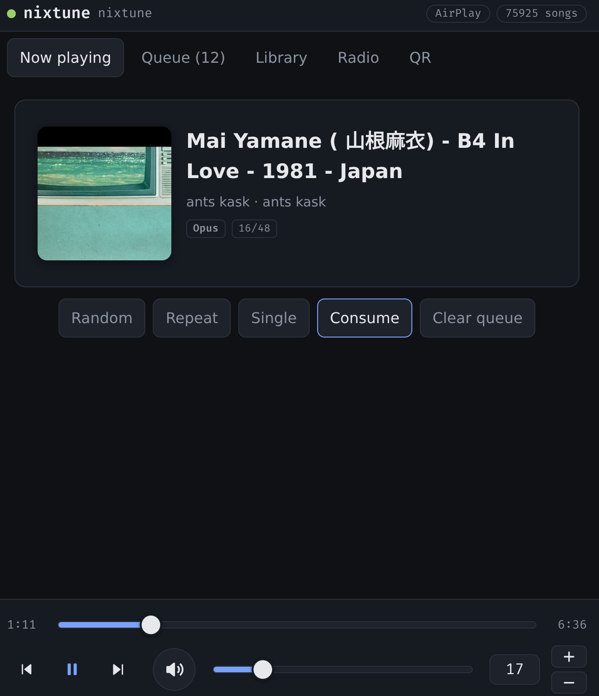
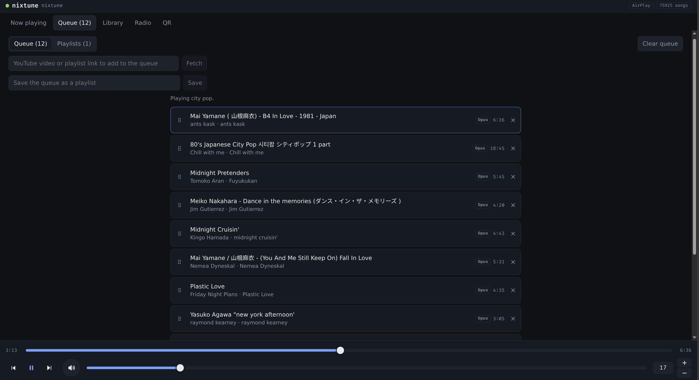
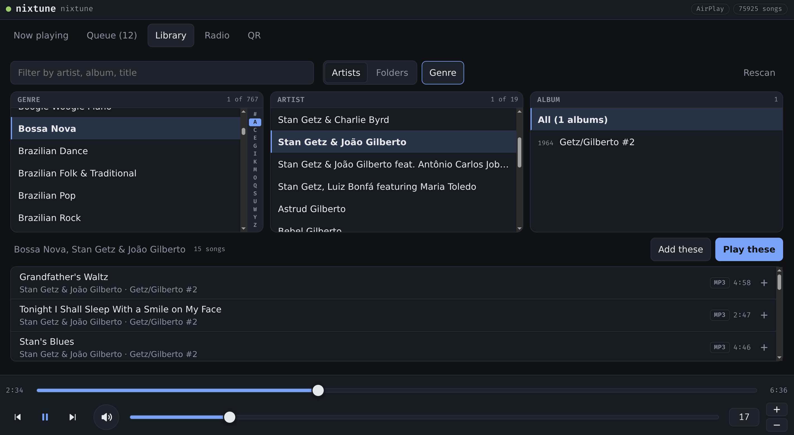
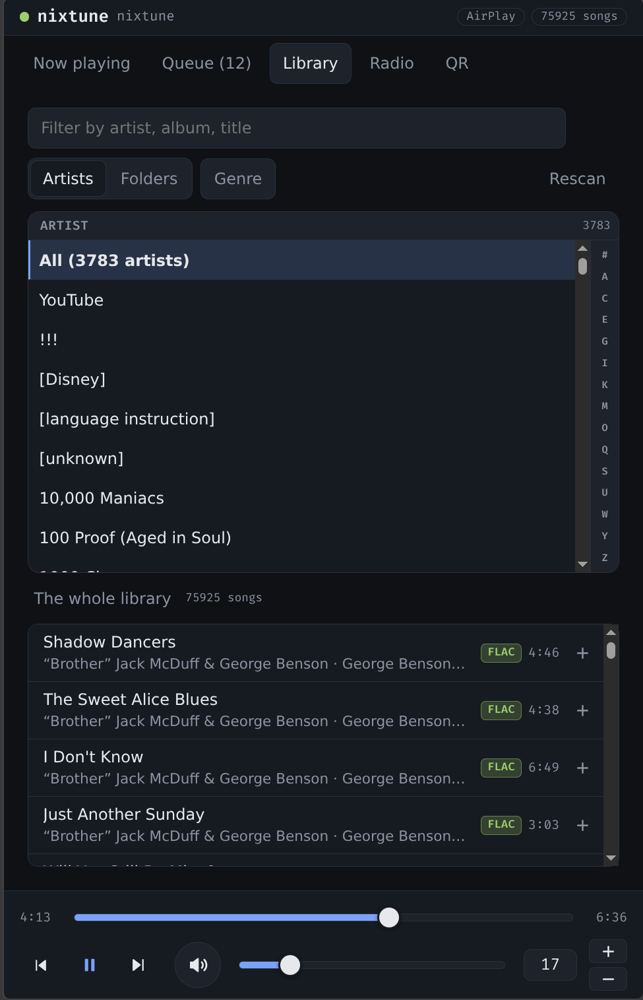
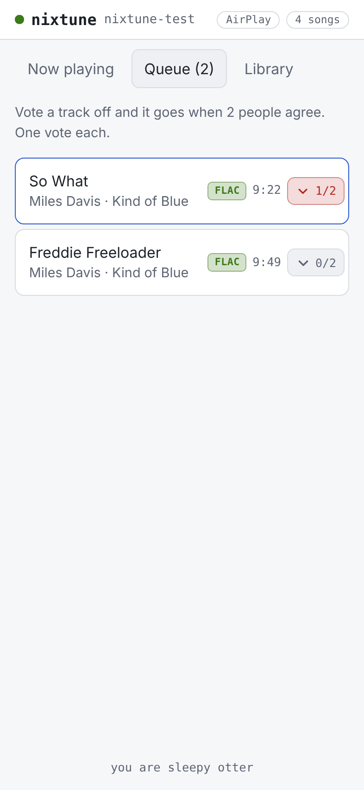

# nixtune

A network music player for a Raspberry Pi and a DAC, declared in NixOS. MPD plays to the card through ALSA with hardware volume and nothing else in the chain. AirPlay and UPnP renderers are modules you turn on. A web page served from the Pi speaks the MPD protocol itself over websockets, so there is no application server. There is no settings database and no settings page either: the configuration is the Nix declaration, and changing it means building a new generation, with the previous one a reboot away.

It does what moOde audio player does for a Pi with a HiFiBerry, with none of moOde's code and none of its runtime configuration machinery.

## What the flake provides

`nixosModules.default` (also `nixosModules.nixtune`) is the whole player: `services.nixtune.*`. Import it and set options. It builds its own packages with the importing host's pkgs, so no overlay is needed.

`packages.<system>.nixtune-web` is the page. `packages.<system>.upmpdcli` is the UPnP renderer, which nixpkgs does not carry; its hashes are not filled in yet, so it does not build (see Known issues).

`checks.<system>.nixtune-web` builds the page. `checks.x86_64-linux.rehearsal` builds a whole system for a QEMU-shaped host with `hardware.profile = "none"`, which is the quickest proof that a change to the module still produces a system.

`devShells.<system>.default` carries purescript, esbuild, nixfmt and spago for working on the page. `formatter.<system>` is nixfmt. Systems are x86_64-linux and aarch64-linux.

The flake does not contain a Pi boot path, an SD image or an example host. Those live in the consuming configuration: import nixos-hardware's `raspberry-pi-5` module and use the generic aarch64 SD image, with `hardware.raspberry-pi.firmware.uboot.enable` set.

## Using it

Import `nixosModules.default` and set `services.nixtune.*`. The section after Options walks through a complete Raspberry Pi 5 from an empty SD card to a player on wifi; this is the short version for a machine that already boots NixOS:

```nix
{
  imports = [ nixtune.nixosModules.default ];

  services.nixtune = {
    enable = true;
    hardware.profile = "pi5-dac2hd";
    library.export = "192.168.1.10:/volume1/music/Music";
  };
}
```

The page is then at `http://<host>/` for guests and `http://<host>/host` for the host.

## Options

`enable` turns the player on. Every optional part below has its own enable flag that defaults to off, and a part that is off contributes no package, unit, firewall rule or tab. The two exceptions are `ui.enable` and `ui.albumArt`, which default to on because a player without them is not a useful default.

`hardware.profile` is `pi5-dac2hd` (the default) or `none`.

`library.export` is the NFS export holding the music, as `host:/path`, or null for radio and renderers only.

`wifi.ssid` and `wifi.pskFile` join a wifi network through NetworkManager. `pskFile` is a runtime path to an environment file holding one line, `PSK=<passphrase>`, so the secret never enters the store. With an SSID and no file, no profile is written and a warning says so, which lets a host boot on ethernet first.

`mpd.port` (6600), `mpd.exposeOnLan` (false), `mpd.maxVolume` (100), `mpd.maxOutputBuffer` (32768 KB), and `mpd.consume`, which is null to let MPD remember the last choice or true or false to set it at every start.

`radio.stations` is a list of `{ name, url }`.

`ui.enable`, `ui.package`, `ui.port` (80), `ui.publicUrl` (what the QR code encodes), `ui.hostPath` (`/host`), `ui.albumArt` (true) and `ui.albumArtSize` (600 pixels on the long edge).

`party.enable` and `party.vetoes` (3) turn on party mode, described under The page.

`youtube.enable`, `youtube.directory` (`_youtube`), `youtube.package` (yt-dlp), `youtube.artist` (`YouTube`), `youtube.maxMinutes` (20), `youtube.maxSize` (`300M`) and `youtube.maxPlaylistItems` (50) configure fetching from YouTube, described below.

`arbitration.resumeAfterRenderer` (true) resumes MPD after an AirPlay stream that paused it ends.

`renderers.airplay.{enable,name}` and `renderers.upnp.{enable,friendlyName,package}`.

`persistPaths` is read-only output for an impermanence setup: the directories nixtune needs kept across a root wipe.

## Provisioning a Raspberry Pi 5, start to finish

This is the whole procedure for a Raspberry Pi 5 with a HiFiBerry DAC2 HD, on an SD card, on wifi, with its music on a NAS over NFS and its secrets in sops. It is how the reference player was built, with the names and addresses replaced. Substitute your own for these:

| In this example | What it is |
| --- | --- |
| `player` | the machine's hostname |
| `player.lan` | the name your router's DNS gives it |
| `admin` | your account on it |
| `MyNetwork` | the wifi network |
| `192.168.1.10` | the NAS |
| `/volume1/music/Music` | the NFS export holding the music |
| `ssh-ed25519 AAAA... you@workstation` | your ssh public key |

Commands are marked with where they run: the **workstation** (a NixOS machine with flakes, using fish) or **player**.

### What you need first

- A NixOS workstation that can build for aarch64. Either set `boot.binfmt.emulatedSystems = [ "aarch64-linux" ];` on it and rebuild, or have an aarch64 machine as a remote builder. Under emulation the first build is slow, because the Raspberry Pi kernel is compiled from source; expect hours.
- An NFS export on the NAS that allows the player's subnet (the Pi's wired and wifi interfaces have different addresses, so allow the subnet, not one address). A missing entry shows up as a mount that times out, not as access denied.
- A router whose DNS names DHCP clients, so the player is reachable as `player.lan` on whichever interface holds the lease.
- An age key of your own for sops, if you do not have one:

**workstation**
```fish
mkdir -p ~/.config/sops/age
```
```fish
nix shell nixpkgs#age --command age-keygen -o ~/.config/sops/age/keys.txt
```
```fish
nix shell nixpkgs#age --command age-keygen -y ~/.config/sops/age/keys.txt
```

The last command prints your public key, `age1...`, which goes in `.sops.yaml` below.

### The configuration

Three files in a git repository. Flakes only see files git tracks, so `git add` every file, the secrets file included, before you build.

`flake.nix`:

```nix
{
  inputs = {
    nixpkgs.url = "github:NixOS/nixpkgs/nixos-unstable";
    nixos-hardware.url = "github:NixOS/nixos-hardware/master";
    sops-nix = {
      url = "github:Mic92/sops-nix";
      inputs.nixpkgs.follows = "nixpkgs";
    };
    nixtune = {
      url = "github:harryprayiv/nixtune";
      inputs.nixpkgs.follows = "nixpkgs";
    };
  };

  outputs =
    {
      self,
      nixpkgs,
      nixos-hardware,
      sops-nix,
      nixtune,
    }:
    {
      nixosConfigurations.player = nixpkgs.lib.nixosSystem {
        modules = [
          nixos-hardware.nixosModules.raspberry-pi-5
          sops-nix.nixosModules.sops
          nixtune.nixosModules.default

          # The generic aarch64 SD image. The same configuration is the
          # image and every later deploy. The first-boot resize is OFF: on
          # the reference card the online resize corrupted directory blocks
          # in the store, so the root is grown offline before first boot.
          (
            { modulesPath, ... }:
            {
              imports = [ (modulesPath + "/installer/sd-card/sd-image-aarch64.nix") ];
              sdImage.compressImage = false;
              sdImage.expandOnBoot = false;
            }
          )

          ./hosts/player.nix
        ];
      };

      packages.aarch64-linux.sd-image = self.nixosConfigurations.player.config.system.build.sdImage;
    };
}
```

`hosts/player.nix`:

```nix
{
  config,
  lib,
  ...
}:
let
  # The secrets are encrypted to this machine's ssh host key, which does
  # not exist until the image has booted once. Until the file exists the
  # player boots on ethernet with a throwaway password and no wifi.
  secretsFile = ../secrets/player.yaml;
  haveSecrets = builtins.pathExists secretsFile;
in
{
  networking.hostName = "player";
  nixpkgs.hostPlatform = "aarch64-linux";
  system.stateVersion = "26.11";

  # ---- Boot: firmware, U-Boot, extlinux, ext4 root -----------------------

  # What a Pi 5 needs to reach an SD card root and nothing else. The
  # sd-image module's own list names modules the Raspberry Pi kernel does
  # not have, and the initrd build fails on the first one missing.
  boot.initrd.availableKernelModules = lib.mkForce [
    "mmc_block"
    "usbhid"
    "hid_generic"
    "usb_storage"
    "xhci_pci"
    "pcie_brcmstb"
    "reset-raspberrypi"
  ];
  boot.loader.grub.enable = false;
  boot.loader.generic-extlinux-compatible.enable = true;
  boot.loader.generic-extlinux-compatible.configurationLimit = 10;

  fileSystems."/" = {
    device = "/dev/disk/by-label/NIXOS_SD";
    fsType = "ext4";
    options = [ "noatime" ];
  };

  # No swap on the SD card; zram gives headroom without writes.
  swapDevices = [ ];
  zramSwap.enable = true;

  # Deploys build on the Pi itself. Four cores and 8 GB OOM at the
  # defaults.
  nix.settings = {
    experimental-features = [
      "nix-command"
      "flakes"
    ];
    trusted-users = [ "admin" ];
    max-jobs = 2;
    cores = 2;
  };

  # ---- Access ------------------------------------------------------------

  users.users.admin = {
    isNormalUser = true;
    extraGroups = [
      "wheel"
      "networkmanager"
    ];
    openssh.authorizedKeys.keys = [ "ssh-ed25519 AAAA... you@workstation" ];
    initialPassword = lib.mkIf (!haveSecrets) "change-me";
    hashedPasswordFile = lib.mkIf haveSecrets config.sops.secrets.user-password.path;
  };

  services.openssh = {
    enable = true;
    settings = {
      PasswordAuthentication = false;
      PermitRootLogin = "no";
    };
  };

  # ---- Secrets -----------------------------------------------------------

  # sops-nix decrypts with this machine's ssh host key by default.
  sops.secrets = lib.mkIf haveSecrets {
    # Read before users are created, so the password can come from it.
    user-password = {
      sopsFile = secretsFile;
      neededForUsers = true;
    };
    # An environment file holding PSK=<passphrase>, which NetworkManager's
    # profile refers to as $PSK.
    wifi-psk = {
      sopsFile = secretsFile;
      restartUnits = [ "NetworkManager-ensure-profiles.service" ];
    };
  };

  # ---- The player --------------------------------------------------------

  services.nixtune = {
    enable = true;
    hardware.profile = "pi5-dac2hd";

    # Music/ only: point the export at the folder that holds music, not at
    # a share that also holds audiobooks or other programs' playlists.
    library.export = "192.168.1.10:/volume1/music/Music";

    wifi.ssid = "MyNetwork";
    wifi.pskFile = lib.mkIf haveSecrets config.sops.secrets.wifi-psk.path;

    renderers.airplay = {
      enable = true;
      name = "player";
    };

    ui.publicUrl = "http://player.lan/";

    radio.stations = [
      {
        name = "GBH 89.7";
        url = "https://wgbh-live.streamguys1.com/wgbh";
      }
    ];

    # Optional; see YouTube for the NAS side.
    youtube.enable = true;
  };

  # Optional, with youtube.enable: the uid of the NAS user that owns the
  # download folder, when the export does no uid mapping. See YouTube.
  # users.users.nixtune-youtube.uid = 1026;
}
```

`.sops.yaml` (the player's key is filled in at step 4):

```yaml
keys:
  - &admin age1youragepublickey
  - &player age1theplayershostkey
creation_rules:
  - path_regex: secrets/player\.yaml$
    key_groups:
      - age:
          - *admin
          - *player
```

### 1. Build the image

**workstation**, in the repository:
```fish
nix build .#packages.aarch64-linux.sd-image
```
```fish
ls result/sd-image/
```

That lists one `.img`; use its name in place of `<name>.img` below. Then find the card:

```fish
lsblk
```

The card is the disk that was not there before you put it in; call it `sdX` below. Unmount its partitions if your desktop mounted them, then write the image:

```fish
sudo dd if=result/sd-image/<name>.img of=/dev/sdX bs=4M status=progress conv=fsync
```

### 2. Grow the root partition offline

The image's root partition is only as big as the system. Grow it to fill the card here, before the first boot, because the image is built with the online resize off.

**workstation**
```fish
udisksctl unmount -b /dev/sdX1
```
```fish
udisksctl unmount -b /dev/sdX2
```
```fish
echo ", +" | sudo sfdisk -N 2 /dev/sdX
```
```fish
sudo partx -u /dev/sdX
```
```fish
nix shell nixpkgs#e2fsprogs --command sudo e2fsck -fy /dev/sdX2
```
```fish
nix shell nixpkgs#e2fsprogs --command sudo resize2fs /dev/sdX2
```
```fish
nix shell nixpkgs#e2fsprogs --command sudo e2fsck -fn /dev/sdX2
```

The last check must print only its summary line and no `Clear?` questions. The unmounts fail harmlessly if nothing was mounted.

### 3. First boot, on ethernet

Put the card in the Pi, plug in an ethernet cable, and power it on. A fresh card has fresh host keys, so forget any old ones for the name, then log in with your ssh key:

**workstation**
```fish
ssh-keygen -R player.lan
```
```fish
ssh admin@player.lan "hostname; df -h /; systemctl --failed --no-pager"
```

That should print `player`, a root filesystem the size of the card, and no failed units. MPD and the page are already running: `http://player.lan/host` works now, on ethernet.

### 4. Encrypt the secrets to the player

Read the player's host key as an age key:

**workstation**
```fish
ssh admin@player.lan cat /etc/ssh/ssh_host_ed25519_key.pub | nix shell nixpkgs#ssh-to-age --command ssh-to-age
```

Put the printed `age1...` in `.sops.yaml` as `player`. Then make the secrets file without the plaintext ever touching a disk: it is staged in `$XDG_RUNTIME_DIR`, which is in memory, and every check prints a length, not a value.

**workstation**, in the repository:
```fish
nix shell nixpkgs#mkpasswd --command mkpasswd -m yescrypt > $XDG_RUNTIME_DIR/hash
```
```fish
string length < $XDG_RUNTIME_DIR/hash
```

That must print 73. Then the wifi passphrase:

```fish
read -s -P "MyNetwork passphrase: " psk
```
```fish
printf 'user-password: %s\nwifi-psk: PSK=%s\n' (cat $XDG_RUNTIME_DIR/hash) $psk > $XDG_RUNTIME_DIR/player.plain.yaml
```
```fish
mkdir -p secrets
```
```fish
nix shell nixpkgs#sops --command sops --encrypt --filename-override secrets/player.yaml $XDG_RUNTIME_DIR/player.plain.yaml > secrets/player.yaml
```
```fish
rm $XDG_RUNTIME_DIR/player.plain.yaml $XDG_RUNTIME_DIR/hash
```
```fish
set -e psk
```
```fish
nix shell nixpkgs#sops --command sops --decrypt --extract '["user-password"]' secrets/player.yaml | string length
```

That must print 73 again; sops-nix refuses an empty value. Then make the files visible to the flake:

```fish
git add .sops.yaml secrets/player.yaml
```

### 5. Deploy, still on ethernet

This builds on the Pi and switches to the new generation. `sudo` on the Pi asks for a password: on this first deploy it is still `change-me`, and from then on it is the one you hashed in step 4.

**workstation**, in the repository:
```fish
nixos-rebuild switch --flake .#player --target-host admin@player.lan --build-host admin@player.lan --sudo --ask-sudo-password
```
```fish
ssh admin@player.lan "nmcli -t -f NAME,DEVICE connection show --active"
```

The second command must list `MyNetwork` beside the wired connection. Deploy over the cable whenever the wifi settings change: the deploy itself travels over the network it is changing.

### 6. Unplug the cable

Power the Pi off, unplug the cable and power it on again. It comes up on wifi, and `player.lan` follows it, because the router names whichever interface holds the lease.

**workstation**
```fish
ssh admin@player.lan "ip -brief addr"
```

The wireless interface has an address and the wired one is down.

### 7. Use it

Open `http://player.lan/host` on the device you control the player from. Its QR tab shows a code that takes guests' phones to `http://player.lan/`. The first library scan starts two minutes after boot and runs in the background; on a large NFS library it can take days, and everything scanned so far is browsable while it runs.

### Changing it later

Edit `hosts/player.nix`, `git add` anything new, and run the same `nixos-rebuild switch` as step 5. To take a newer nixtune, run `nix flake update nixtune` first. Every deploy is a new generation, and the previous one is in the boot menu.

If the page fails to build with a segfault from `purs`, your nixpkgs is newer than the one the prebuilt PureScript compiler works with; pin your `nixpkgs` input to the revision in nixtune's own `flake.lock` until that is fixed upstream.

## Hardware

One profile today, `pi5-dac2hd`: a Raspberry Pi 5 with a HiFiBerry DAC2 HD. The DAC's overlay, `hifiberry-dacplushd`, is applied two ways so that whichever device tree the kernel is given carries it: as a `config.txt` line for the GPU firmware, and at build time onto the generation's device tree with its compatible string rewritten for the Pi 5, because nixpkgs skips an overlay whose compatible string does not match the board. The ALSA card is addressed by name, `sndrpihifiberry`, so the Pi's HDMI audio devices cannot take its place by renumbering. Volume is the card's hardware control, `DAC`.

A second profile, `none`, plays into a null output, for a rehearsal VM.

Adding a DAC is a new entry in `nix/module/hardware.nix`: the overlay name, the ALSA card name and the mixer control.

## The library

The export is mounted read-only at `/srv/music` over NFS, as an automount with `nofail`, so a NAS that is down does not block boot, and with `soft` timeouts, so a NAS that stops answering gives MPD an error instead of a process stuck in the kernel. MPD's own `auto_update` is off, because on a large NFS library it installs inotify watches over the whole tree before it reports ready, and inotify never fires for NFS writes anyway. A timer runs `mpc update` two minutes after boot and daily instead. A first scan of a large library runs for days in the background; everything already scanned is browsable while it runs.

MPD's URIs are relative to its music directory, so changing the export would leave a database full of entries whose files are somewhere else. The export in force is recorded beside the database and checked before every MPD start, and a mismatch removes the database so the next scan rebuilds it.

Of MPD's nine playlist plugins only m3u and extm3u are on, because MPD needs them to load and list its own saved playlists. The library's own playlist files are indexed as a result and the page leaves them out. The rest stay off, so an album ripped as one file with a `.cue` is one long track.

## Volume

MPD reads the DAC2 HD's volume correctly and cannot write it: it sets volume through ALSA's dB path whenever a control's range is wider than 24 dB, and on this card every such write lands on the hard mute. So MPD keeps the mixer for reading, which is how every client learns the level, and writes go to a small helper that runs `amixer -M`, the same mapped write amixer does on the command line. The page reaches it through a socket-activated systemd unit, websocat and nginx at `/volume`. The scale is ALSA's normalized mapping, which is what MPD reports, so the number the page sends and the number MPD reports back mean the same thing. On a host without a real card the helper is not built and the page uses MPD's `setvol`.

## Cover art

Most libraries keep the cover inside the files, which nginx cannot serve and MPD can only hand over as binary that a text websocket cannot carry. So the player builds a cache: one `cover.jpg` per album directory under `/var/lib/nixtune/art`, mirroring the library's layout, taken from a picture file beside the audio when there is one and extracted with ffmpeg from the first track otherwise. It runs ten minutes after boot and every six hours, niced and at idle IO priority, and after the first run it only touches album directories that changed. nginx serves only `.jpg` files from that tree, at `/art/`, so no audio is reachable over HTTP.

## The page

A Halogen application in `packages/nixtune-web/`. It opens three websockets to MPD through websocat: one for commands and their replies, one parked in MPD's `idle` command so changes arrive as they happen instead of being polled, and one for the library, so a large library query never waits behind a queue read. Every reply is collected outside the component's state, so a reply of any length costs one render. What the page may show comes from `capabilities.json`, which Nix writes beside it at build time, so a renderer that is off has no badge and a host with no library has no library tab.

There are two pages from one bundle. The guest page, at `/`, shows what is playing and lets a guest browse the library and add to the end of the queue. Each guest browser makes up a nickname for itself, and what it adds is attributed to that nickname with an MPD sticker, which the host page shows beside each queue entry. The host page, at `ui.hostPath`, has everything, and a QR code that takes a phone to the guest page. The limit between the two is what each page offers: both reach the same websocket, and anyone on the LAN who opens a browser console can send any MPD command. That is the intended trust model for a room of invited people.

**Now playing** shows the track, its cover, its format, the depth and rate the DAC is being fed, and who added it. On the host it also has the four MPD playback modes and Clear queue, which takes two presses within three seconds because MPD has no undo for `clear`. There is no Stop.

**The player bar** sits under every host view: the position with a seek bar, then previous, play/pause and next, mute, and the volume slider, with a typed level and steppers on screens 30rem and wider. The level glides to a new value in small steps.

**Queue** lists the queue with the current track marked and the played ones dimmed. The host can drag a row by its handle, or focus the handle and use the arrow keys, to reorder; tap a row to play it; and remove rows. Above the queue the host has a field for a YouTube link and a field to save the queue as a playlist.

**Playlists** is the other half of the Queue tab: the playlists saved on the player, which are MPD's stored playlists and survive reboots. Each can be played (replacing the queue), added to the end of the queue, opened, or deleted (two presses). An open playlist can be renamed, reordered by drag or arrow keys, and have rows removed, and the whole queue can be appended to it, which is how tracks get into an existing playlist. Saving under a name that already exists replaces that playlist after a second press. Every change is one MPD command and the page shows the result only when MPD reports it, so two pages open on the same playlist stay in step.

**Library** is a column browser in the style of the old iTunes library view: album artist, then album, with an optional genre column to the left, and the tracks they narrow to underneath. The artist column is AlbumArtist, which MPD falls back to Artist for, so a compilation is one row. Columns are ordered by the page, using the `*Sort` tags where a file has them and the browser's locale-aware comparison, so "The Beatles" tagged "Beatles, The" sits under B and lower-case names sort among the rest. Albums are in year order once an artist is selected. A click picks one value, shift extends, and ctrl or cmd adds or removes one; several values in a column become one regular-expression filter, so any selection is one MPD command per column. A search box narrows every column and the track list as you type. Long columns get a letter rail, which shows fewer letters on a short screen. Only the rows on screen are in the page, so a column of ten thousand artists or a track list of seventy thousand songs scrolls like a short one. The whole-library column lists are kept in the browser between visits, keyed on MPD's database stamp, so they reload only after a rescan. Tracks can be picked and queued together. A folder view shows the library as MPD indexes it.

**Radio** plays the stations declared in `radio.stations`. **QR** shows the code for the guest page.

**Party mode**, with `party.enable`, gives guests the queue, read only, with a vote against each track. When `party.vetoes` different guests have voted against a track it leaves the queue. The tally is an MPD sticker, so every browser sees the same count and nothing on the Pi keeps score. It is not a voting system: a guest who clears their browser storage can vote again.

## YouTube

With `youtube.enable`, the host page's Queue tab has a field for a YouTube link. A video link fetches that video; a playlist link fetches up to `youtube.maxPlaylistItems` of its videos in order. Each one is downloaded with yt-dlp as the best audio stream YouTube offers, without re-encoding, tagged and given its thumbnail as a cover, copied into `youtube.directory` on the NAS, indexed by MPD and added to the end of the queue as soon as it lands. Pasting a link whose file is already there queues the existing file.

The downloads are part of the library. Every one is tagged with album artist `youtube.artist`, "YouTube" unless you set another, and the page pins that artist to the top of the artist column. The album is YouTube's album name when it has one and the channel name otherwise. Search finds them like anything else. Retag a file with a real album artist and it moves into the rest of the library; rename it, but keep the `[<id>]` in the name, or the same link fetches it again.

The helper is a socket-activated systemd unit with the same shape as the volume helper, reached at `/youtube`. It never hands the browser's URL to yt-dlp: it takes the video or playlist id out of a youtube.com or youtu.be link and builds the URL from the id alone, and refuses anything else. yt-dlp runs with `--ignore-config`, a length limit that also refuses live streams, a size limit, a fifteen-minute limit per video, and one download at a time. Anyone who can reach the page can use it.

Setting it up:

1. Create `youtube.directory` at the top of the library export on the NAS. Only that folder is mounted read-write, at `/srv/nixtune-youtube`; the library stays read-only.
2. The export has to let the player write to that folder. A Synology export with no uid mapping checks the client's uid against the folder's permissions, and its POSIX mode bits do not show what its ACLs allow. Either give the folder write permission for the uid the helper runs as (the `nixtune-youtube` user; set `users.users.nixtune-youtube.uid` to a uid the NAS knows), or map all users to admin on the export.
3. Set `services.nixtune.youtube.enable = true` and rebuild.

YouTube changes what yt-dlp has to do every few weeks. When fetches start failing with extractor errors, update the flake or point `youtube.package` at a newer yt-dlp.

## Renderers

**AirPlay** runs shairport-sync straight to the DAC. A hook before its first frame pauses MPD if it was playing, and a hook after its last resumes it if it was the one that paused it. MPD releases the card on pause, so AirPlay can open it.

**UPnP** runs upmpdcli, which drives MPD over the protocol rather than opening the card. Its package does not build yet.

## Home Assistant

`mpd.exposeOnLan = true` binds MPD to every address and opens port 6600, and Home Assistant's MPD integration connects to it directly. Transport, the queue and saved playlists work. Volume does not: Home Assistant sets volume with `setvol`, which mutes this card (see Volume).

## First boot on wifi

The wifi passphrase is a secret, and a secret encrypted to the host needs the host's key, which does not exist until the image has booted once. So the first boot is on ethernet, the host key is read, the secret is written, and the next deploy brings the wifi profile. Steps 3 to 6 of the walkthrough above are exactly that.

## Building the page

The page is built from `packages/nixtune-web/spago.lock` with nothing but nixpkgs: each registry package in the lock is one fixed-output fetch of its registry tarball, checked against the lock's hash, then compiled with `purs` and bundled with esbuild into `index.html` and `index.js`. There is no network access during the build and no hand-written JavaScript. To change dependencies, run `spago install` or `spago upgrade` from the dev shell in `packages/nixtune-web` and commit `spago.yaml` and `spago.lock` together.

## Known issues

- `packages.<system>.upmpdcli` has placeholder hashes and does not build, so `renderers.upnp` cannot be enabled.
- The CI workflow builds `.#web` and `.#checks.x86_64-linux.example-eval`, which no longer exist, so it fails. It should build `.#nixtune-web` and `.#checks.x86_64-linux.rehearsal`.
- The flake's nixpkgs is pinned because nixpkgs' prebuilt purs segfaults on newer revisions.
- MPD's `setvol` mutes the DAC2 HD, so any MPD client other than the page, Home Assistant included, mutes the room when it sets volume.
- shairport-sync is given the hardware mixer, and nobody has yet checked whether its writes hold on this card.
- The page reads the whole queue and the whole of an open playlist at once. Both are fine at a few hundred tracks and are meant to become windowed reads.
- Nothing on the root filesystem is ephemeral yet; `persistPaths` is published for when it is.

## Notes

I made massive changes to this to iterate on the complex task of an everyday-use audio interface. There are a lot of non-obvious properties of such a module that I had to arrive at through experimentation. I have lots of ambition here and will continue to iterate.

Screenshots:






## Maintenance




## Maintenance

`nix flake update` on the `update` branch, the workflow in `.github/workflows/check.yml`, merge to `main`. Nothing else.

## Licence

AGPL-3.0-or-later.
