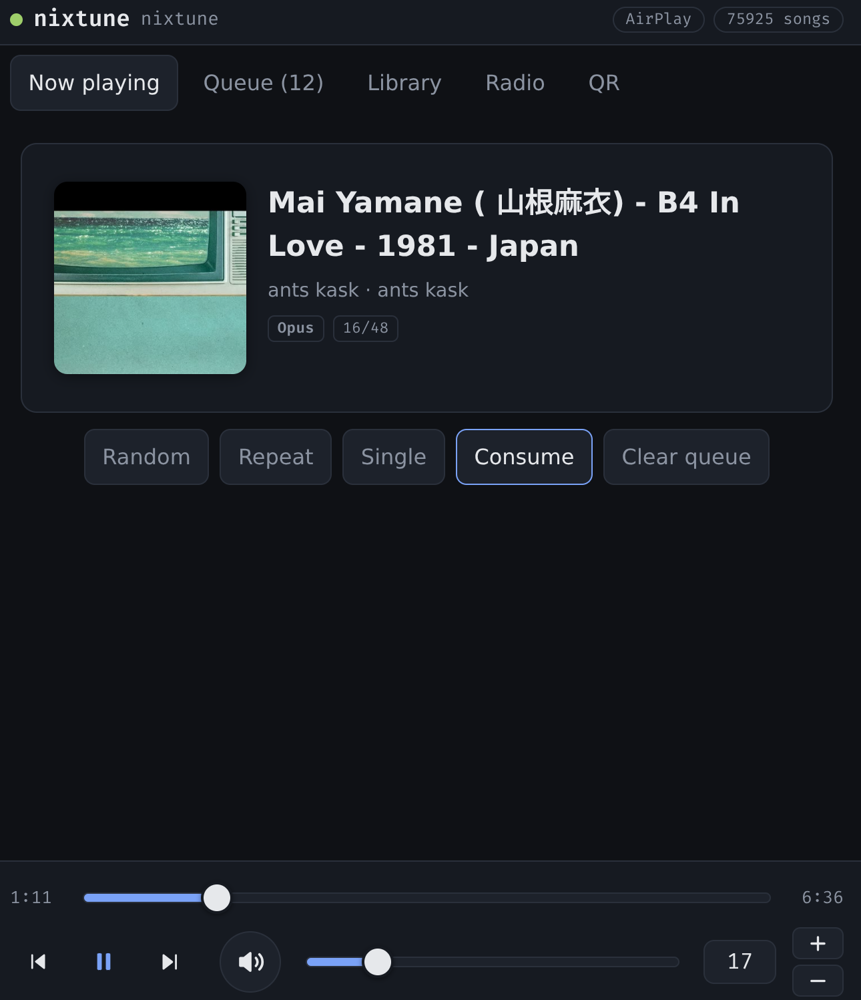
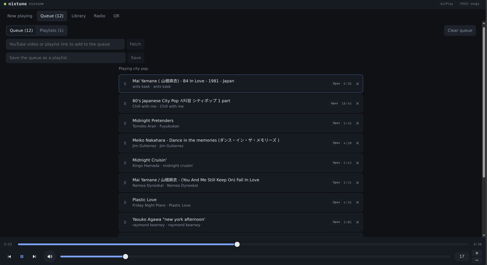
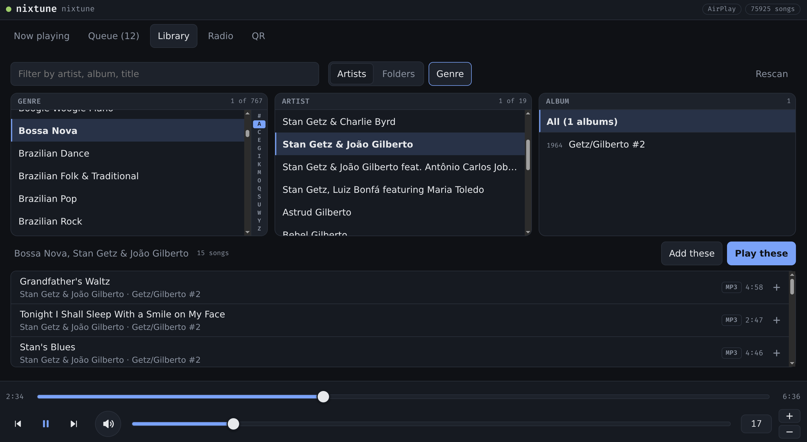
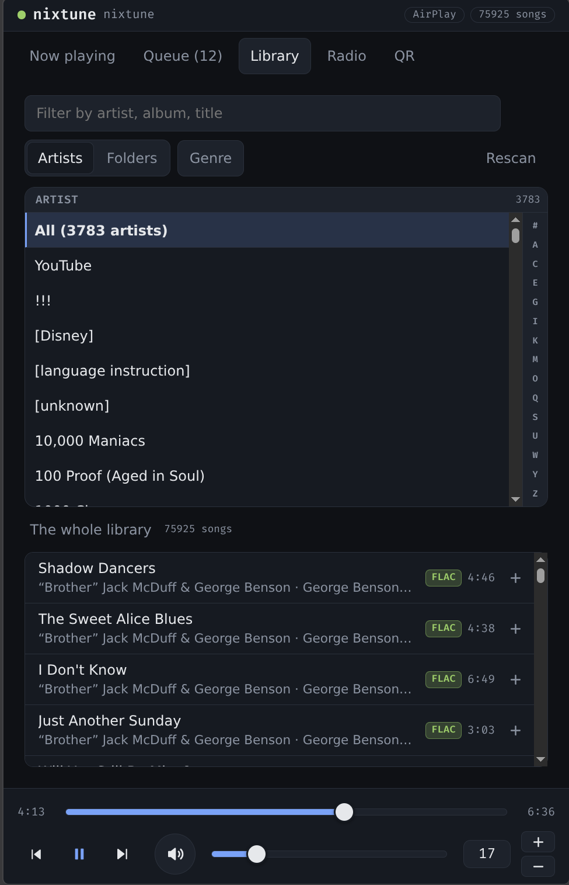

# nixtune

A network music player for a Raspberry Pi, declared in NixOS. With a DAC, MPD plays to the card through ALSA with hardware volume and nothing else in the chain; every HiFiBerry card can be named by product, and a Pi with no DAC plays through its own headphone jack or HDMI, or a USB DAC (see Hardware). AirPlay 2 and UPnP renderers are modules you turn on. A web page served from the Pi speaks the MPD protocol itself over websockets, so there is no application server. There is no settings database and no settings page either: the configuration is the Nix declaration, and changing it means building a new generation, with the previous one a reboot away.

It does what moOde audio player does for a Pi with a HiFiBerry, with none of moOde's code and none of its runtime configuration machinery.

## What the flake provides

`nixosModules.default` (also `nixosModules.nixtune`) is the whole player: `services.nixtune.*`. Import it and set options. It builds its own packages with the importing host's pkgs, so no overlay is needed.

`packages.<system>.nixtune-web` is the page. `packages.<system>.nixtune-room` is the multiroom coordinator and Sendspin server, and `packages.<system>.sendspin` is the Sendspin player every room runs: sendspin-cli at a pinned release with nixtune's patches (see Multiroom and Maintenance). `packages.<system>.upmpdcli` is the UPnP renderer, which nixpkgs does not carry; its hashes are not filled in yet, so it does not build (see Known issues).

`overlays.sendspin` puts the same aiosendspin and sendspin releases into every Python package set of a host that applies it. The module does not need it; it is for a workstation that wants to run `sendspin` by hand against a room.

`nixosModules.raspberry-pi-02`, `raspberry-pi-3`, `raspberry-pi-4` and `raspberry-pi-5` are the Raspberry Pi layer for a Zero 2 W, a Pi 3, a Pi 4 or 400, and a Pi 5. Each brings [nixos-raspberrypi](https://github.com/nvmd/nixos-raspberrypi)'s board support: the Raspberry Pi kernel and firmware, the firmware partition and `config.txt`, and its binary cache, so the kernel is downloaded rather than compiled. Each also sets `hardware.board` for you. `nixosModules.sd-image` is nixos-raspberrypi's SD card image, partitions and all. `nix/raspberry-pi.nix` says what they do and why.

`packages.<system>.shairport-sync` is nixpkgs' AirPlay 2 build of shairport-sync with nixtune's one patch, which binds AirPlay 2's stream ports in a fixed range (see Renderers); the module uses it for AirPlay 2.

`checks.<system>.nixtune-web`, `checks.<system>.nixtune-room`, `checks.<system>.sendspin` and `checks.<system>.shairport-sync` build the packages, which runs their test suites. `checks.x86_64-linux.rehearsal` builds a whole system for a QEMU-shaped host with `hardware.board = "other"` and `hardware.audio = "none"`, which is the quickest proof that a change to the module still produces a system; `checks.x86_64-linux.rehearsal-multiroom` does the same for a room with multiroom on, and `checks.x86_64-linux.rehearsal-airplay` for a USB DAC with AirPlay 2. `checks.x86_64-linux.multiroom` boots two rooms in VMs and plays a group (see Testing a change to multiroom); it needs KVM. `checks.aarch64-linux.pi5-dac2hd`, `pi4-amp100`, `pi400-hdmi`, `pi3-headphones` and `zero2w-dacplus-zero` build a whole Raspberry Pi system for each board, with a different output on each. `checks.x86_64-linux.pi5-dac2hd-nixos-hardware` evaluates the reference player on nixos-hardware and builds none of it, because that kernel has no binary cache; it catches a change that breaks that path's options, not one that breaks its build. The flake's `nixos-hardware` input exists for this check alone.

`devShells.<system>.default` carries purescript, esbuild, nixfmt and spago for working on the page, and `devShells.<system>.room` carries GHC, cabal and the C libraries for working on `packages/nixtune-room`. `formatter.<system>` is nixfmt. Systems are x86_64-linux and aarch64-linux.

The flake has no example host: the walkthrough below is one. nixos-hardware's Raspberry Pi modules still work in place of nixtune's, as they did before; the module writes `config.txt` for whichever of the two a host imports (see With nixos-hardware instead).

## Using it

Import `nixosModules.default` and set `services.nixtune.*`. The section after Options walks through a complete Raspberry Pi 5 from an empty SD card to a player on wifi, and the one after it adds more rooms that play in sync; this is the short version for a machine that already boots NixOS:

```nix
{
  imports = [
    nixtune.nixosModules.default
    nixtune.nixosModules.raspberry-pi-5
  ];

  services.nixtune = {
    enable = true;
    hardware.audio = "dac2hd";
    library.export = "192.168.1.10:/volume1/music/Music";
  };
}
```

A stock Raspberry Pi 4 with nothing added plays through its headphone jack with `nixosModules.raspberry-pi-4` and `audio = "headphones"`, and a Pi with a HiFiBerry DAC+ Pro on it with `audio = "hifiberry"` and `hifiberry = "dacplus-pro"`; Hardware lists every board, output and card.

The page is then at `http://<host>/` for guests and `http://<host>/host` for the host.

## Options

`enable` turns the player on. Every optional part below has its own enable flag that defaults to off, and a part that is off contributes no package, unit, firewall rule or tab. The two exceptions are `ui.enable` and `ui.albumArt`, which default to on because a player without them is not a useful default.

`hardware.board` is the computer: `pi5` (the default), `pi400`, `pi4`, `pi3`, `zero2w` or `other`; nixtune's raspberry-pi modules set it. `hardware.audio` is where the sound leaves it: `dac2hd` (the default), `hifiberry`, `headphones`, `hdmi`, `usb`, `hat` or `none`. `hardware.hifiberry` names the card for `hifiberry`, by product. `hardware.hdmiPort` (0) picks the port for `hdmi` on a board with two. `hardware.card.id`, `hardware.card.mixer`, `hardware.card.overlay` and `hardware.card.convert` (false) describe the card for `usb` and `hat`; `card.mixer` renames the headphone jack's control or a HiFiBerry card's, and `card.convert` lets MPD convert for a HiFiBerry card too. `hardware.profile` is the single option of earlier releases, kept so their hosts still build: `"pi5-dac2hd"` means board `pi5` with audio `dac2hd`, and `"none"` means board `other` with audio `none`. See Hardware.

`library.export` is the NFS export holding the music, as `host:/path`, or null for radio and renderers only.

`wifi.ssid` and `wifi.pskFile` join a wifi network through NetworkManager. `pskFile` is a runtime path to an environment file holding one line, `PSK=<passphrase>`, so the secret never enters the store. With an SSID and no file, no profile is written and a warning says so, which lets a host boot on ethernet first.

`mpd.port` (6600), `mpd.exposeOnLan` (false), `mpd.maxVolume` (100), `mpd.maxOutputBuffer` (32768 KB), and `mpd.consume`, which is null to let MPD remember the last choice or true or false to set it at every start.

`radio.stations` is a list of `{ name, url }`.

`ui.enable`, `ui.package`, `ui.port` (80), `ui.publicUrl` (what the QR code encodes), `ui.hostPath` (`/host`), `ui.albumArt` (true) and `ui.albumArtSize` (600 pixels on the long edge).

`party.enable` and `party.vetoes` (3) turn on party mode, described under The page.

`youtube.enable`, `youtube.directory` (`_youtube`), `youtube.package` (yt-dlp), `youtube.artist` (`YouTube`), `youtube.maxMinutes` (20), `youtube.maxSize` (`300M`) and `youtube.maxPlaylistItems` (50) configure fetching from YouTube, described below.

`arbitration.resumeAfterRenderer` (true) resumes MPD after an AirPlay stream that paused it ends.

`renderers.airplay.{enable,name,version}`, where `version` is 2 (the default, AirPlay 2) or 1, and `renderers.upnp.{enable,friendlyName,package}`.

`multiroom.enable` turns on multiroom, described under Multiroom. `multiroom.room` is this room's name (the hostname by default). `multiroom.peers.<room>` declares every room in the home, this one included, with `host`, `port` (80), `serverKey`, `playerKey` and `outputDelay` (0 milliseconds). `multiroom.acoustics.<focus>.<room>` is the travel time in milliseconds from `<room>`'s speakers to the listening spot in `<focus>`. `multiroom.streamFormat` (`44100:24:2`) is what a group streams. `multiroom.playerCard` (the output card) and `multiroom.playerCardDevice` (0) are the ALSA device the player opens; on an output MPD converts for (headphones, HDMI) the player converts the same way. `multiroom.secrets.serverKeyFile`, `multiroom.secrets.playerKeyFile`, `multiroom.secrets.serverPskFiles.<room>` and `multiroom.secrets.playerPskFiles.<room>` are runtime paths to the room's keys. `multiroom.timing` holds `audienceGrace` (10000), `orphanTimeout` (180000), `playerReadyTimeout` (10000), `maxSuspension` (1800000), `reconcileInterval` (2000) and `peerTimeout` (2000), all milliseconds. `multiroom.package` and `multiroom.playerPackage` replace the two programs.

`persistPaths` is read-only output for an impermanence setup: the directories nixtune needs kept across a root wipe.

## Provisioning a Raspberry Pi 5, start to finish

This is the whole procedure for a Raspberry Pi 5 with a HiFiBerry DAC2 HD, on an SD card, on wifi, with its music on a NAS over NFS and its secrets in sops. It is how the reference player was built, with the names and addresses replaced. A different Pi, or a Pi with no DAC, follows the same steps with the few changes listed under On another board, or without a DAC, after the configuration files. Substitute your own for these:

| In this example | What it is |
| --- | --- |
| `player` | the machine's hostname |
| `player.lan` | the name your router's DNS gives it |
| `admin` | your account on it |
| `MyNetwork` | the wifi network |
| `192.168.1.10` | the NAS |
| `/volume1/music/Music` | the NFS export holding the music |
| `ssh-ed25519 AAAA... you@workstation` | your ssh public key |

Commands are marked with where they run: the **workstation** (a NixOS machine with flakes, using fish) or **player**.

### What you need first

- A supported Raspberry Pi (see Minimum hardware under Hardware), an SD card of 16 GB or more, and a power supply that meets the Pi's own rating.
- A NixOS workstation that can build for aarch64. Either set `boot.binfmt.emulatedSystems = [ "aarch64-linux" ];` on it and rebuild, or have an aarch64 machine as a remote builder. Give it nixos-raspberrypi's binary cache, so the Raspberry Pi kernel and firmware are downloaded rather than compiled under emulation (which takes hours). In the workstation's own configuration:

```nix
  nix.settings = {
    extra-substituters = [ "https://nixos-raspberrypi.cachix.org" ];
    extra-trusted-public-keys = [
      "nixos-raspberrypi.cachix.org-1:4iMO9LXa8BqhU+Rpg6LQKiGa2lsNh/j2oiYLNOQ5sPI="
    ];
  };
```

- An NFS export on the NAS that allows the player's subnet (the Pi's wired and wifi interfaces have different addresses, so allow the subnet, not one address). A missing entry shows up as a mount that times out, not as access denied.
- A router whose DNS names DHCP clients, so the player is reachable as `player.lan` on whichever interface holds the lease.
- An age key of your own for sops, if you do not have one:

**workstation**
```fish
mkdir -p ~/.config/sops/age
```
```fish
nix shell nixpkgs#age --command age-keygen -o ~/.config/sops/age/keys.txt
```
```fish
nix shell nixpkgs#age --command age-keygen -y ~/.config/sops/age/keys.txt
```

The last command prints your public key, `age1...`, which goes in `.sops.yaml` below.

### The configuration

Three files in a git repository. Flakes only see files git tracks, so `git add` every file, the secrets file included, before you build.

`flake.nix`:

```nix
{
  inputs = {
    nixpkgs.url = "github:NixOS/nixpkgs/nixos-unstable";
    sops-nix = {
      url = "github:Mic92/sops-nix";
      inputs.nixpkgs.follows = "nixpkgs";
    };
    # Not nixtune's nixos-raspberrypi input: leave that one alone, so the
    # kernel is the one in nixos-raspberrypi's binary cache.
    nixtune = {
      url = "github:harryprayiv/nixtune";
      inputs.nixpkgs.follows = "nixpkgs";
    };
  };

  outputs =
    {
      self,
      nixpkgs,
      sops-nix,
      nixtune,
    }:
    {
      nixosConfigurations.player = nixpkgs.lib.nixosSystem {
        modules = [
          nixtune.nixosModules.raspberry-pi-5
          sops-nix.nixosModules.sops
          nixtune.nixosModules.default

          # The SD image. The same configuration is the image and every
          # later deploy. The first-boot resize is OFF: on the reference
          # card nixpkgs' online resize corrupted directory blocks in the
          # store, so the root is grown offline before first boot.
          nixtune.nixosModules.sd-image
          {
            sdImage.compressImage = false;
            sdImage.expandOnBoot = false;
          }

          ./hosts/player.nix
        ];
      };

      packages.aarch64-linux.sd-image = self.nixosConfigurations.player.config.system.build.sdImage;
    };
}
```

`hosts/player.nix`:

```nix
{
  config,
  lib,
  ...
}:
let
  # The secrets are encrypted to this machine's ssh host key, which does
  # not exist until the image has booted once. Until the file exists the
  # player boots on ethernet with a throwaway password and no wifi.
  secretsFile = ../secrets/player.yaml;
  haveSecrets = builtins.pathExists secretsFile;
in
{
  networking.hostName = "player";
  nixpkgs.hostPlatform = "aarch64-linux";
  system.stateVersion = "26.11";

  # The boot path, the firmware partition, config.txt and both
  # filesystems come from nixosModules.raspberry-pi-5 and
  # nixosModules.sd-image.

  # No swap on the SD card; zram gives headroom without writes.
  swapDevices = [ ];
  zramSwap.enable = true;

  # Deploys build on the Pi itself. Four cores and 8 GB OOM at the
  # defaults.
  nix.settings = {
    experimental-features = [
      "nix-command"
      "flakes"
    ];
    trusted-users = [ "admin" ];
    max-jobs = 2;
    cores = 2;
  };

  # ---- Access ------------------------------------------------------------

  users.users.admin = {
    isNormalUser = true;
    extraGroups = [
      "wheel"
      "networkmanager"
    ];
    openssh.authorizedKeys.keys = [ "ssh-ed25519 AAAA... you@workstation" ];
    initialPassword = lib.mkIf (!haveSecrets) "change-me";
    hashedPasswordFile = lib.mkIf haveSecrets config.sops.secrets.user-password.path;
  };

  services.openssh = {
    enable = true;
    settings = {
      PasswordAuthentication = false;
      PermitRootLogin = "no";
    };
  };

  # ---- Secrets -----------------------------------------------------------

  # sops-nix decrypts with this machine's ssh host key by default.
  sops.secrets = lib.mkIf haveSecrets {
    # Read before users are created, so the password can come from it.
    user-password = {
      sopsFile = secretsFile;
      neededForUsers = true;
    };
    # An environment file holding PSK=<passphrase>, which NetworkManager's
    # profile refers to as $PSK.
    wifi-psk = {
      sopsFile = secretsFile;
      restartUnits = [ "NetworkManager-ensure-profiles.service" ];
    };
  };

  # ---- The player --------------------------------------------------------

  services.nixtune = {
    enable = true;
    hardware.audio = "dac2hd";

    # Music/ only: point the export at the folder that holds music, not at
    # a share that also holds audiobooks or other programs' playlists.
    library.export = "192.168.1.10:/volume1/music/Music";

    wifi.ssid = "MyNetwork";
    wifi.pskFile = lib.mkIf haveSecrets config.sops.secrets.wifi-psk.path;

    renderers.airplay = {
      enable = true;
      name = "player";
    };

    ui.publicUrl = "http://player.lan/";

    radio.stations = [
      {
        name = "GBH 89.7";
        url = "https://wgbh-live.streamguys1.com/wgbh";
      }
    ];

    # Optional; see YouTube for the NAS side.
    youtube.enable = true;
  };

  # Optional, with youtube.enable: the uid of the NAS user that owns the
  # download folder, when the export does no uid mapping. See YouTube.
  # users.users.nixtune-youtube.uid = 1026;
}
```

`.sops.yaml` (the player's key is filled in at step 4):

```yaml
keys:
  - &admin age1youragepublickey
  - &player age1theplayershostkey
creation_rules:
  - path_regex: secrets/player\.yaml$
    key_groups:
      - age:
          - *admin
          - *player
```

### On another board, or without a DAC

Everything above holds for every supported Raspberry Pi, with these changes.

In `flake.nix`, import the module for the board in place of `raspberry-pi-5`. It sets `hardware.board`:

| Board | nixtune module | `hardware.board` it sets |
| --- | --- | --- |
| Raspberry Pi 5, 500, Compute Module 5 | `nixtune.nixosModules.raspberry-pi-5` | `"pi5"` |
| Raspberry Pi 4 B, Compute Module 4 | `nixtune.nixosModules.raspberry-pi-4` | `"pi4"` |
| Raspberry Pi 400 | `nixtune.nixosModules.raspberry-pi-4`, and set `hardware.board = "pi400"` | `"pi4"` |
| Raspberry Pi 3 B, 3 B+, 3 A+ | `nixtune.nixosModules.raspberry-pi-3` | `"pi3"` |
| Raspberry Pi Zero 2 W | `nixtune.nixosModules.raspberry-pi-02` | `"zero2w"` |

In `hosts/player.nix`, set `hardware.audio` in `services.nixtune` for what you have. For a stock Pi 4 into an amplifier through the 3.5 mm jack:

```nix
  services.nixtune = {
    enable = true;
    hardware.audio = "headphones";
    # the rest as above
  };
```

For a stock Pi 5 into a TV or an AV receiver over HDMI, using the port next to the power connector:

```nix
    hardware = {
      audio = "hdmi";
      hdmiPort = 0;
    };
```

For a HiFiBerry card other than the DAC2 HD, by its product name (see HiFiBerry cards under Hardware):

```nix
    hardware = {
      audio = "hifiberry";
      hifiberry = "dacplus-pro";
    };
```

On a board with less than 4 GB of memory, a Pi 3, a Zero 2 W or a small Pi 4, do not build on the Pi. Leave `--build-host admin@player.lan` out of the `nixos-rebuild` command in step 5 and later, so the workstation builds and copies the result over, and delete the `nix.settings` block's `max-jobs` and `cores` lines, which only matter for building on the Pi.

The Pi 3 B's wifi is 2.4 GHz only. A Pi 400 and a Zero 2 W have no headphone jack, so use `hdmi`, `usb` or a HiFiBerry card on them; `audio = "headphones"` on either fails the build with a message saying so.

Changing `hardware.board` or `hardware.audio` on a running player changes `config.txt`, which the Pi's firmware reads only at power-on, so reboot after the `nixos-rebuild switch`.

### With nixos-hardware instead

The reference Pi 5 was first provisioned this way, and nixtune still supports it. Import `nixos-hardware.nixosModules.raspberry-pi-5` (or `-4`, or `-3` for a Pi 3 and a Zero 2 W) in place of nixtune's board module, set `hardware.board` yourself, and use nixpkgs' generic aarch64 SD image, `(modulesPath + "/installer/sd-card/sd-image-aarch64.nix")`, in place of `nixosModules.sd-image`. The host then also needs:

```nix
  # What a Pi 5 needs to reach an SD card root and nothing else. The
  # sd-image module's own list names modules the Raspberry Pi kernel does
  # not have, and the initrd build fails on the first one missing.
  boot.initrd.availableKernelModules = lib.mkForce [
    "mmc_block"
    "usbhid"
    "hid_generic"
    "usb_storage"
    "xhci_pci"
    "pcie_brcmstb"
    "reset-raspberrypi"
  ];
  boot.loader.grub.enable = false;
  boot.loader.generic-extlinux-compatible.enable = true;
  boot.loader.generic-extlinux-compatible.configurationLimit = 10;

  fileSystems."/" = {
    device = "/dev/disk/by-label/NIXOS_SD";
    fsType = "ext4";
    options = [ "noatime" ];
  };
```

nixtune turns on `hardware.raspberry-pi.firmware.uboot.enable`, which a board needs to boot on this path, and writes the card's overlay both into `config.txt` and onto the generation's device tree. The difference that matters: nixos-hardware has no binary cache, so the Raspberry Pi kernel is compiled from source, which takes hours under emulation.

Moving a running player from nixos-hardware to nixtune's board modules means a new SD card. nixos-raspberrypi keeps each generation's kernel, initrd and device trees on the firmware partition, which its image makes 1 GB, and the generic aarch64 image makes about 30 MB.

### 1. Build the image

**workstation**, in the repository:
```fish
nix build .#packages.aarch64-linux.sd-image
```
```fish
ls result/sd-image/
```

That lists one `.img`; use its name in place of `<name>.img` below. Then find the card:

```fish
lsblk
```

The card is the disk that was not there before you put it in; call it `sdX` below. Unmount its partitions if your desktop mounted them, then write the image:

```fish
sudo dd if=result/sd-image/<name>.img of=/dev/sdX bs=4M status=progress conv=fsync
```

### 2. Grow the root partition offline

The image's root partition is only as big as the system. Grow it to fill the card here, before the first boot, because the image is built with the online resize off.

**workstation**
```fish
udisksctl unmount -b /dev/sdX1
```
```fish
udisksctl unmount -b /dev/sdX2
```
```fish
echo ", +" | sudo sfdisk -N 2 /dev/sdX
```
```fish
sudo partx -u /dev/sdX
```
```fish
nix shell nixpkgs#e2fsprogs --command sudo e2fsck -fy /dev/sdX2
```
```fish
nix shell nixpkgs#e2fsprogs --command sudo resize2fs /dev/sdX2
```
```fish
nix shell nixpkgs#e2fsprogs --command sudo e2fsck -fn /dev/sdX2
```

The last check must print only its summary line and no `Clear?` questions. The unmounts fail harmlessly if nothing was mounted.

### 3. First boot, on ethernet

Put the card in the Pi, plug in an ethernet cable, and power it on. A fresh card has fresh host keys, so forget any old ones for the name, then log in with your ssh key:

**workstation**
```fish
ssh-keygen -R player.lan
```
```fish
ssh admin@player.lan "hostname; df -h /; systemctl --failed --no-pager"
```

That should print `player`, a root filesystem the size of the card, and no failed units. MPD and the page are already running: `http://player.lan/host` works now, on ethernet.

### 4. Encrypt the secrets to the player

Read the player's host key as an age key:

**workstation**
```fish
ssh admin@player.lan cat /etc/ssh/ssh_host_ed25519_key.pub | nix shell nixpkgs#ssh-to-age --command ssh-to-age
```

Put the printed `age1...` in `.sops.yaml` as `player`. Then make the secrets file without the plaintext ever touching a disk: it is staged in `$XDG_RUNTIME_DIR`, which is in memory, and every check prints a length, not a value.

**workstation**, in the repository:
```fish
nix shell nixpkgs#mkpasswd --command mkpasswd -m yescrypt > $XDG_RUNTIME_DIR/hash
```
```fish
string length < $XDG_RUNTIME_DIR/hash
```

That must print 73. Then the wifi passphrase:

```fish
read -s -P "MyNetwork passphrase: " psk
```
```fish
printf 'user-password: %s\nwifi-psk: PSK=%s\n' (cat $XDG_RUNTIME_DIR/hash) $psk > $XDG_RUNTIME_DIR/player.plain.yaml
```
```fish
mkdir -p secrets
```
```fish
nix shell nixpkgs#sops --command sops --encrypt --filename-override secrets/player.yaml $XDG_RUNTIME_DIR/player.plain.yaml > secrets/player.yaml
```
```fish
rm $XDG_RUNTIME_DIR/player.plain.yaml $XDG_RUNTIME_DIR/hash
```
```fish
set -e psk
```
```fish
nix shell nixpkgs#sops --command sops --decrypt --extract '["user-password"]' secrets/player.yaml | string length
```

That must print 73 again; sops-nix refuses an empty value. Then make the files visible to the flake:

```fish
git add .sops.yaml secrets/player.yaml
```

### 5. Deploy, still on ethernet

This builds on the Pi and switches to the new generation. `sudo` on the Pi asks for a password: on this first deploy it is still `change-me`, and from then on it is the one you hashed in step 4.

**workstation**, in the repository:
```fish
nixos-rebuild switch --flake .#player --target-host admin@player.lan --build-host admin@player.lan --sudo --ask-sudo-password
```
```fish
ssh admin@player.lan "nmcli -t -f NAME,DEVICE connection show --active"
```

The second command must list `MyNetwork` beside the wired connection. Deploy over the cable whenever the wifi settings change: the deploy itself travels over the network it is changing.

### 6. Unplug the cable

Power the Pi off, unplug the cable and power it on again. It comes up on wifi, and `player.lan` follows it, because the router names whichever interface holds the lease.

**workstation**
```fish
ssh admin@player.lan "ip -brief addr"
```

The wireless interface has an address and the wired one is down.

### 7. Use it

Open `http://player.lan/host` on the device you control the player from. Its QR tab shows a code that takes guests' phones to `http://player.lan/`. The first library scan starts two minutes after boot and runs in the background; on a large NFS library it can take days, and everything scanned so far is browsable while it runs.

### Changing it later

Edit `hosts/player.nix`, `git add` anything new, and run the same `nixos-rebuild switch` as step 5. To take a newer nixtune, run `nix flake update nixtune` first. Every deploy is a new generation, and the previous one is in the boot menu.

If the page fails to build with a segfault from `purs`, your nixpkgs is newer than the one the prebuilt PureScript compiler works with; pin your `nixpkgs` input to the revision in nixtune's own `flake.lock` until that is fixed upstream.

## Multiroom

With `services.nixtune.multiroom.enable`, a room can play another room's music in time with it, and serve its own music to other rooms. Each room is one nixtune host. A room playing alone keeps the path it has without multiroom, MPD straight to the room's output, bit for bit on a DAC. Only while a room is part of a group does its MPD also feed a fifo, resampled to `multiroom.streamFormat`, and the room's own Sendspin server streams that to the players of every room in the group, its own included, with timestamps so they all play the same sample at the same moment.

Two services run beside MPD on every room. `nixtune-room` is the room's coordinator and its Sendspin server in one process: it decides what the room's DAC plays, talks to the other rooms' coordinators through their nginx at `/room`, and reads MPD's fifo when the room is a source. `nixtune-player` is sendspin-cli's player on the room's DAC, listening on port 8928 for the servers of the declared rooms and nothing else. The two never have the DAC open at once: the coordinator turns MPD's ALSA output off before the player is held, and turns it back on only after the player reports that it has closed the device.

Rooms authenticate each other with keys you generate once for the whole home. Every room has a server key and a player key, and every ordered pair of rooms (this room's server, that room's player) shares a pre-shared key. The public keys go in the Nix declaration; the private keys and the pre-shared keys go in each room's sops file. A server or player that does not hold the right keys for a pair is refused.

This section is the recommended way to set it up. It extends the Raspberry Pi walkthrough above, and uses two rooms, `kitchen` and `lab`; a home with more rooms differs only in the list of names.

### What you need first

- Every room set up as a single player with the walkthrough above, through step 6: booted, reachable over ssh, deployed from the repository, with its ssh host key's age key in `.sops.yaml`.
- Each room's hostname is its room name: lower case letters, digits and hyphens, starting with a letter. The coordinator takes the room name from `networking.hostName`. The walkthrough's `player` would become `kitchen` here.
- Every room can reach every other room by the name you give it, here `kitchen.lan` and `lab.lan`. The router's DNS names from the walkthrough are enough. A name that resolves to an IPv6 address first is fine.
- `ui.enable` left on (the default) on every room. The coordinators reach each other through the page's nginx.
- The rooms on one network with no firewall between them for ports 80 and 8928. The module opens both on each room.

### The files

Three new files in the repository, and two changes to existing ones:

```
rooms/keys.nix                 public keys, written by nixtune-room keys
rooms/peers.nix                every room and how to reach it
rooms/default.nix              the module every room imports
secrets/kitchen-multiroom.yaml the kitchen's private keys, encrypted
secrets/lab-multiroom.yaml     the lab's private keys, encrypted
.sops.yaml                     one new rule per room
flake.nix                      one host per room, each importing ./rooms
```

The multiroom secrets are kept in a file of their own per room rather than added to the room's existing secrets file, so that generating new keys for the home never touches anything else.

### 1. Generate the keys

`nixtune-room keys` makes every key and pre-shared key for the whole home in one run. It writes one plaintext file per room into the directory you give it, mode 0600, and refuses to overwrite anything, and it prints the public keys as a Nix attrset. Write the plaintext into `$XDG_RUNTIME_DIR`, which is in memory, and the public keys into the repository:

**workstation**, in the repository:
```fish
mkdir -p rooms
```
```fish
nix run github:harryprayiv/nixtune#nixtune-room -- keys --rooms kitchen,lab --out $XDG_RUNTIME_DIR/nixtune-room-keys > rooms/keys.nix
```

It prints `wrote` and a path for each room. `rooms/keys.nix` now holds `serverKey` and `playerKey` for each room. These are public keys, safe to commit.

### 2. Encrypt each room's keys to that room

Add one rule per room to `.sops.yaml`, beside the rules for the rooms' existing secrets files, each listing your key and that room's key:

```yaml
keys:
  - &admin age1youragepublickey
  - &kitchen age1thekitchenshostkey
  - &lab age1thelabshostkey
creation_rules:
  - path_regex: secrets/kitchen\.yaml$
    key_groups:
      - age:
          - *admin
          - *kitchen
  - path_regex: secrets/kitchen-multiroom\.yaml$
    key_groups:
      - age:
          - *admin
          - *kitchen
  - path_regex: secrets/lab\.yaml$
    key_groups:
      - age:
          - *admin
          - *lab
  - path_regex: secrets/lab-multiroom\.yaml$
    key_groups:
      - age:
          - *admin
          - *lab
```

Then encrypt each room's file and delete the plaintext. Every check prints a length, never a value.

**workstation**, in the repository:
```fish
nix shell nixpkgs#sops --command sops --encrypt --filename-override secrets/kitchen-multiroom.yaml $XDG_RUNTIME_DIR/nixtune-room-keys/kitchen.yaml > secrets/kitchen-multiroom.yaml
```
```fish
nix shell nixpkgs#sops --command sops --encrypt --filename-override secrets/lab-multiroom.yaml $XDG_RUNTIME_DIR/nixtune-room-keys/lab.yaml > secrets/lab-multiroom.yaml
```
```fish
rm -r $XDG_RUNTIME_DIR/nixtune-room-keys
```
```fish
nix shell nixpkgs#sops --command sops --decrypt --extract '["nixtune-room"]["server-key"]' secrets/kitchen-multiroom.yaml | string length
```
```fish
nix shell nixpkgs#sops --command sops --decrypt --extract '["nixtune-room"]["server-psk"]["lab"]' secrets/kitchen-multiroom.yaml | string length
```

Both must print 43, the length of a 32-byte key in unpadded base64url. Run the same two checks on `secrets/lab-multiroom.yaml`, with `kitchen` in place of `lab` in the second. Each room's file holds its server key, its player key, a `server-psk` for every room (this room's server with that room's player) and a `player-psk` for every room (this room's player with that room's server), its own pairing included.

### 3. Declare the rooms

`rooms/peers.nix` is every room in the home and how the others reach it. It is identical on every room, which is why it is one file every room imports:

```nix
# Every room in the home, identical on every room. serverKey and
# playerKey come from keys.nix, which `nixtune-room keys` wrote; host is
# how the other rooms reach this one.
let
  keys = import ./keys.nix;
in
{
  kitchen = keys.kitchen // {
    host = "kitchen.lan";
  };
  lab = keys.lab // {
    host = "lab.lan";
  };
}
```

A room's entry can also set `port`, when its page is not on port 80, and `outputDelay`, the milliseconds between its DAC's output and the sound leaving its speakers. That is 0 for a DAC feeding an amplifier with no DSP in between; a room with an active speaker or a DSP stage that delays the signal sets its delay here.

`rooms/default.nix` is the module every room imports. It takes the room from the hostname, the peers from `peers.nix`, and the room's own keys from its sops file, and turns multiroom on only once that file exists, so a new room plays alone until its keys are in place:

```nix
# Multiroom for every room. Every room imports this one file: the peers
# and the acoustics are the same everywhere, and each room takes its own
# keys from its own sops file. The room is the host's name.
{ config, lib, ... }:
let
  peers = import ./peers.nix;
  rooms = lib.attrNames peers;
  room = config.networking.hostName;

  # Encrypted to this room's ssh host key, so it can exist only after the
  # room has booted once. Until it does, the room plays alone.
  sopsFile = ../secrets + "/${room}-multiroom.yaml";
  haveKeys = builtins.pathExists sopsFile;

  # The server's key and PSKs are read by nixtune-room, the player's by
  # nixtune-player. A changed secret restarts the service that reads it.
  forServer = {
    inherit sopsFile;
    owner = "nixtune-room";
    restartUnits = [ "nixtune-room.service" ];
  };
  forPlayer = {
    inherit sopsFile;
    owner = "nixtune-player";
    restartUnits = [ "nixtune-player.service" ];
  };
  path = name: config.sops.secrets.${name}.path;

  # The account you log in with. It joins the nixtune-room group, so
  # `nixtune-room ctl` works over ssh without sudo.
  operator = "admin";
in
{
  config = lib.mkIf haveKeys {
    sops.secrets = {
      "nixtune-room/server-key" = forServer;
      "nixtune-room/player-key" = forPlayer;
    }
    // lib.genAttrs (map (r: "nixtune-room/server-psk/${r}") rooms) (_: forServer)
    // lib.genAttrs (map (r: "nixtune-room/player-psk/${r}") rooms) (_: forPlayer);

    users.users.${operator}.extraGroups = [ "nixtune-room" ];

    services.nixtune.multiroom = {
      enable = true;
      inherit room peers;
      # Milliseconds of sound travel, the same on every room; see
      # Acoustics below.
      acoustics = { };
      secrets = {
        serverKeyFile = path "nixtune-room/server-key";
        playerKeyFile = path "nixtune-room/player-key";
        serverPskFiles = lib.genAttrs rooms (r: path "nixtune-room/server-psk/${r}");
        playerPskFiles = lib.genAttrs rooms (r: path "nixtune-room/player-psk/${r}");
      };
    };
  };
}
```

The secret names are the paths inside the room's sops file, so `nixtune-room/server-psk/lab` is both the key sops-nix reads and the file it writes, `/run/secrets/nixtune-room/server-psk/lab`.

`flake.nix` makes one host per room, from the same list of names, each importing `./rooms` and its own `hosts/<room>.nix` (the walkthrough's `hosts/player.nix`, with the room's hostname and its own secrets file):

```nix
{
  inputs = {
    nixpkgs.url = "github:NixOS/nixpkgs/nixos-unstable";
    sops-nix = {
      url = "github:Mic92/sops-nix";
      inputs.nixpkgs.follows = "nixpkgs";
    };
    nixtune = {
      url = "github:harryprayiv/nixtune";
      inputs.nixpkgs.follows = "nixpkgs";
    };
  };

  outputs =
    {
      self,
      nixpkgs,
      sops-nix,
      nixtune,
    }:
    let
      lib = nixpkgs.lib;

      # One host per room, named after it; peers.nix is the list.
      rooms = lib.attrNames (import ./rooms/peers.nix);

      # Each room imports its own board's module from its hosts file, or
      # every room is a Pi 5 and this list says so once.
      room =
        name:
        lib.nixosSystem {
          modules = [
            nixtune.nixosModules.raspberry-pi-5
            sops-nix.nixosModules.sops
            nixtune.nixosModules.default
            nixtune.nixosModules.sd-image
            {
              sdImage.compressImage = false;
              sdImage.expandOnBoot = false;
            }
            ./rooms
            (./hosts + "/${name}.nix")
          ];
        };
    in
    {
      nixosConfigurations = lib.genAttrs rooms room;

      # nix build .#packages.aarch64-linux.kitchen is the kitchen's SD image.
      packages.aarch64-linux = lib.genAttrs rooms (
        name: self.nixosConfigurations.${name}.config.system.build.sdImage
      );
    };
}
```

A room added later is a new entry in `peers.nix`, a new `hosts/<room>.nix`, and the walkthrough for its card; the flake picks it up from the list. Its keys need the steps under Adding or removing a room.

### 4. Deploy every room

Make the new files visible to the flake, then deploy each room the way the walkthrough does. Deploy every room in the same sitting: a room's keys only work with the keys of the same run on the other rooms.

**workstation**, in the repository:
```fish
git add rooms secrets/kitchen-multiroom.yaml secrets/lab-multiroom.yaml .sops.yaml flake.nix
```
```fish
nixos-rebuild switch --flake .#kitchen --target-host admin@kitchen.lan --build-host admin@kitchen.lan --sudo --ask-sudo-password
```
```fish
nixos-rebuild switch --flake .#lab --target-host admin@lab.lan --build-host admin@lab.lan --sudo --ask-sudo-password
```

The first deploy builds nixtune-room (Haskell) and the Sendspin player (Python) on each Pi, running both test suites, which takes a while on a Pi.

### 5. Check each room

The group membership from `rooms/default.nix` takes effect on a new login, so these are fresh ssh sessions.

**workstation**
```fish
ssh admin@kitchen.lan "systemctl is-active nixtune-room nixtune-player; nixtune-room ctl status"
```

That prints `active` twice and a status line starting `status room=kitchen intent=own` with `path=direct` in it. Then check that the secrets arrived, by length only:

```fish
ssh -t admin@kitchen.lan "sudo wc -c /run/secrets/nixtune-room/server-key /run/secrets/nixtune-room/player-key"
```

Each is 43 bytes. Repeat both for `lab.lan`.

### 6. Group the rooms

There is no rooms panel on the page yet, so grouping is done with `nixtune-room ctl` on the room that changes. Start music on the lab from its page, then:

**workstation**
```fish
ssh admin@kitchen.lan "nixtune-room ctl follow lab"
```

It prints `ok` once the kitchen is playing the lab's music. The kitchen's status now reads `intent=following source=lab path=peer-server`, and the lab's reads `audience=kitchen path=own-server`. To take the kitchen back to its own queue:

```fish
ssh admin@kitchen.lan "nixtune-room ctl own"
```

The lab keeps streaming for ten seconds (`multiroom.timing.audienceGrace`) in case someone joins again, then goes back to playing straight to its DAC.

### Using a group

Every request goes to the coordinator of the room it is about, with `nixtune-room ctl <request>` on that room, and is answered `ok` or `refused <reason>`:

| Request | What it does |
| --- | --- |
| `follow <room>` | This room plays `<room>`'s music. Its own MPD pauses where it was. |
| `own` | This room goes back to its own queue, paused where it left it. |
| `silence` | This room's speakers go quiet. A room that others are following keeps serving them. |
| `pin <room>` | The room whose listening spot the group's timing is aligned to (see Acoustics), on the source room. `unpin` lets the source choose again. |
| `status` | One line: what this room intends, what it follows, who follows it, and the path its DAC is on. |

The refusals are `unknown-room` (not in `peers.nix`), `self`, `interrupted` (an AirPlay stream holds the room), `busy` (another request for this room is still waiting), `source-unreachable` (the source's coordinator did not answer) and `player-not-ready` (the source could not reach this room's player in time; see Troubleshooting).

While a room follows another, the music is the source's: play, pause, skip and the queue are on the source room's page. The follower's own page shows its own paused queue. Volume is per room: each room's page still sets its own DAC's hardware volume, and that is the level its speakers play the group at.

A follower that loses its source, because the source rebooted or dropped off the network, keeps trying to reach it for three minutes (`multiroom.timing.orphanTimeout`), longer than a Pi takes to reboot, and then goes back to its own queue, paused.

AirPlay still works on every room. When an AirPlay stream starts on a room that is following, the room steps out of the group for as long as the stream lasts, and goes back to following when it ends; the source keeps its place for up to thirty minutes (`multiroom.timing.maxSuspension`). When AirPlay starts on a source, its followers keep playing the source's music.

The `/room` websocket that pages and peers use speaks the same requests, one per line, and anyone on the LAN can send them, as anyone on the LAN can send MPD commands to the page's websocket. Port 8928, which carries the audio, accepts only the declared rooms' servers, through Noise with the pre-shared keys.

### Acoustics

A group plays in time at each room's DAC. Sound then takes time to travel, about 2.9 milliseconds per metre, so a listener standing in one room hears that room's speakers before the speakers in the next room. `multiroom.acoustics` declares those travel times, and the source delays the nearer rooms so that the sound from every room arrives together at one listening spot, the focus.

`acoustics.<focus>.<room>` is the number of milliseconds from `<room>`'s speakers to the listening spot in `<focus>`, `<focus>` included. For a kitchen listener 2 metres from the kitchen speakers and 6 metres from the lab's, and a lab listener 2 metres from the lab speakers and 6 metres from the kitchen's:

```nix
acoustics = {
  kitchen = {
    kitchen = 6;
    lab = 17;
  };
  lab = {
    lab = 6;
    kitchen = 17;
  };
};
```

Leave a room out of a focus where it cannot be heard. The focus is the source room while it plays its own queue, otherwise the first follower by name; `pin <room>` on the source fixes it. Without `acoustics` every room is aligned at its DAC, which is right for rooms you cannot hear from each other. A calibration by ear from the page is specified but not built yet, so the numbers come from a tape measure. Declare them in `rooms/default.nix`, because every room must hold the same ones.

### Adding or removing a room, or replacing the keys

The pre-shared keys are per pair of rooms, so a change to the list of rooms is a new run of `nixtune-room keys` for the whole home: run step 1 with the new list into an empty directory (it writes `rooms/keys.nix` again), add or remove the `.sops.yaml` rules, run step 2 for every room, edit `peers.nix`, and deploy every room in the same sitting. A room still holding keys from the earlier run is refused by the others until it is deployed. The same procedure replaces every key, for instance after a card is lost.

### Troubleshooting

Every check here prints states and log lines, never a secret.

**workstation**
```fish
ssh admin@kitchen.lan "nixtune-room ctl status; mpc outputs"
```
```fish
ssh admin@kitchen.lan "journalctl -b -u nixtune-room -u nixtune-player --no-pager -n 100"
```

`mpc outputs` shows what MPD is actually doing, which is what to compare with the status line: a room alone (`path=direct`) has its DAC output enabled and `(multiroom)` disabled, a source (`path=own-server`) has its DAC output disabled and `(multiroom)` enabled, and a follower (`path=peer-server`) has both disabled. These are the messages that matter, and what each one means:

| Log line | Meaning |
| --- | --- |
| `the server key's public half is ..., but this room is declared with ...` | nixtune-room refuses to start: the room's server key and its `serverKey` in `keys.nix` are from different runs of `nixtune-room keys`. |
| `PSK for <room>: ...` | A pre-shared key file is missing or is not a 32-byte key. Check the lengths as in step 5. |
| `<room>'s player: does not hold this server's PSK (it answered with the Sentinel); its pairing store needs provisioning` | That room's player has keys from a different run. Deploy every room from the same run. |
| `<room>'s player: answered with client_id ..., not the declared player key` | The player that answered is not the one `peers.nix` declares for that room: a wrong `host`, or keys from a different run. |
| `<room>'s player: ...; trying again while it is held` | Nothing listens on that room's port 8928 yet. Normal for a moment while a player restarts; if a follow then fails `player-not-ready`, look at that room's own log. |
| `Audio device 'nixtune' not found. Waiting for it to become available.` | The player started while another program had the DAC open, and waits for it. Something other than MPD is holding the card, since the coordinator frees it from MPD before the player needs it. |
| `<source> did not answer hold <room>: ...` | The follower could not reach the source's coordinator through `http://<source host>/room`: a name that does not resolve, a source that is down, or a source without multiroom enabled. |
| `the player did not report the DAC closed within 3 seconds; going on` | The player's stop hook did not reach the coordinator. The coordinator waits three seconds and goes on, and MPD may then find the card busy. |
| `effect Act ... failed: ...` | A switch the coordinator meant to make did not happen; `mpc outputs` shows the result. |
| `<room>'s player is a second behind; a chunk was dropped` | That room's network or player fell more than a second behind the group. A weak wifi link is the usual cause. |

### What the network carries

A group streams uncompressed PCM at `multiroom.streamFormat`, 44.1 kHz, 24 bits, stereo by default: about 2.1 Mbit/s to each room in the group, the source's own player included, which stays on the source. Most music libraries are 44.1 kHz, which then is not resampled, and 16-bit files pass through 24 bits unchanged. FLAC in the stream is planned.

### Testing a change to multiroom

`checks.x86_64-linux.multiroom` boots two rooms in VMs, with the player on snd-aloop in place of a DAC, and checks a whole cycle: both rooms start alone, the lab plays, the kitchen follows, both players receive and play the stream for a minute with no underflow or dropped chunk, the kitchen goes back to its own queue and both rooms' MPD outputs are switched back, and a player started while something else holds the DAC waits for it. It needs a machine with KVM:

**workstation**, in a checkout of nixtune:
```fish
nix build .#checks.x86_64-linux.multiroom -L
```

`checks.x86_64-linux.rehearsal-multiroom` only builds a room's system, which is quicker and needs no KVM. The VMs cannot show how well the rooms keep time with each other: that needs real rooms and ears.

## Hardware

The hardware is two choices: `hardware.board`, the computer, and `hardware.audio`, where the sound leaves it. A combination the board does not have, such as the headphone jack on a Pi 5 or HDMI on a machine that is not a Pi, fails the build with a message that says why. Where this README says the DAC, read the room's output.

Only the Raspberry Pi 5 with the HiFiBerry DAC2 HD has been run on hardware, and only on the nixos-hardware path. Every other board, output and HiFiBerry card below, and every board on nixtune's own raspberry-pi modules, has been checked by evaluating its configuration to a system, against nixos-hardware's Raspberry Pi kernel 6.18.50 and nixos-raspberrypi's 6.18.59; the card names, control names, overlay parameters and device strings come from the kernel and alsa-lib sources. Expect to be the first to play through them, and see Finding a card's names if one does not appear as described.

### Minimum hardware

A 64-bit Raspberry Pi with at least 1 GB of memory:

| Board | `hardware.board` | Memory | Building on the Pi |
| --- | --- | --- | --- |
| Raspberry Pi 5, 500, Compute Module 5 | `pi5` | 1 GB or more | with 4 GB or more; done on 8 GB |
| Raspberry Pi 4 B, Compute Module 4 | `pi4` | 1 GB or more | with 4 GB or more; not yet tried |
| Raspberry Pi 400 | `pi400` | 4 GB | not yet tried |
| Raspberry Pi 3 B, 3 B+, 3 A+ | `pi3` | 1 GB (512 MB on the 3 A+) | no |
| Raspberry Pi Zero 2 W | `zero2w` | 512 MB | no |

The Pi 1, Pi 2, original Zero and Zero W are not supported. They are 32-bit, nixpkgs has no binary cache for them, so every package would compile on your workstation under emulation, and both Raspberry Pi layers' kernels for this setup are 64-bit. The Zero 2 W and the 3 A+, with 512 MB, are below the 1 GB this is meant for and have not been tried; a single room without multiroom is the most to expect of them.

Memory matters most for building. The reference Pi 5 has 8 GB and builds its own generations only with Nix's parallelism turned down (`max-jobs` and `cores` in the walkthrough), so a board with less than 4 GB should always be deployed from the workstation (see On another board, or without a DAC). Playing needs much less: MPD, nginx and the helpers are small, and multiroom adds the Sendspin player, a Python program.

An SD card of 16 GB or more: each generation keeps its own system, and a few of them are kept so you can roll back. Ethernet or wifi both work; a stereo stream is a few megabits even in a multiroom group.

Any computer that is not a Pi and runs NixOS works too, with `board = "other"` and a USB DAC.

### Outputs

| `hardware.audio` | Boards | What it is | Volume | Bit-perfect |
| --- | --- | --- | --- | --- |
| `dac2hd` | any Pi | HiFiBerry DAC2 HD, the reference | the card's `DAC` control | yes |
| `hifiberry` | any Pi | the HiFiBerry card `hardware.hifiberry` names | the card's control, where it has one | yes, on the DACs |
| `headphones` | Pi 3, Pi 4 B | the 3.5 mm jack | the card's `PCM` control | no: 16 bits, 48 kHz at most |
| `hdmi` | any Pi | the HDMI port, to a TV or AV receiver | MPD's software volume | no: converted by alsa-lib's HDMI plugin |
| `usb` | any | a USB DAC or sound card | its control, if `card.mixer` names one | yes, unless `card.convert` |
| `hat` | any Pi | any other DAC HAT | its control, if `card.mixer` names one | yes, unless `card.convert` |
| `none` | any | no sound, for a rehearsal VM | MPD's software volume | n/a |

**dac2hd** is a Raspberry Pi with a HiFiBerry DAC2 HD. The DAC's overlay, `hifiberry-dacplushd`, goes into `config.txt`, where the GPU firmware applies it. On nixos-hardware it is also applied at build time onto the generation's device tree, with its compatible string rewritten for the board, because nixpkgs skips an overlay whose compatible string does not match the board, so that whichever device tree U-Boot is given carries it. On nixtune's raspberry-pi modules the firmware boots the kernel with the tree it built, and `config.txt` is the only place the overlay goes. The ALSA card is addressed by name, `sndrpihifiberry`, so the Pi's own audio devices cannot take its place by renumbering. Volume is the card's hardware control, `DAC`. This is the best output nixtune has, and the one to buy for if you are buying.

**hifiberry** is any HiFiBerry card, named by product in `hardware.hifiberry`; see HiFiBerry cards below. The card's overlay, with any parameter it needs, goes into `config.txt` the same way as the DAC2 HD's, and the card is `sndrpihifiberry` too. `audio = "dac2hd"` and `audio = "hifiberry"` with `hifiberry = "dac2hd"` are the same output.

On every output but `headphones`, the Pi's own analog audio is switched off in `config.txt` (`dtparam=audio=off`) and its driver, `snd_bcm2835`, is not loaded, so `/proc/asound/cards` lists only the card that plays.

**headphones** is the Pi's own 3.5 mm jack, on a Pi 3 B, 3 B+, 3 A+ and Pi 4 B. It is a PWM output from the SoC, not a DAC: it takes 16 bits at up to 48 kHz, so MPD resamples and reduces anything better, and its noise floor is audible on good speakers. It is fine for a kitchen radio or a first try, and it needs nothing but a cable. Volume is the card's `PCM` control; if `amixer` on your Pi shows another name, set `hardware.card.mixer` to it.

**hdmi** sends digital audio to a TV or an AV receiver over one of the Pi's HDMI ports: `hardware.hdmiPort` 0 (the default; next to the power connector on a Pi 4 and Pi 5) or 1. The Pi 3 and Zero 2 W have one port, 0. The TV or receiver must be connected, and on, when the Pi boots: the Pi only offers HDMI audio to a display that says it takes audio. The Pi's HDMI accepts audio only in IEC958 frames, so every program reaches it through alsa-lib's HDMI plugin, and MPD converts to what the plugin takes. The port has no volume control of its own, so MPD scales the samples; leave the page at 100 and use the receiver's volume for the best result. On nixos-hardware this output turns on the Pi's display driver (`vc4-kms-v3d`), which the others leave off. nixos-raspberrypi keeps the display driver on for every output, and every output but this one turns its HDMI audio off (`noaudio`).

**usb** is a USB DAC or sound card, named by its ALSA card id in `hardware.card.id`. Most USB DACs take every rate and depth they advertise, so MPD hands them the file as it is. If MPD's log says it cannot open the output for some files, the card refuses those formats: set `hardware.card.convert = true` and MPD converts them. Set `hardware.card.mixer` to the card's volume control if it has one; without it, MPD's software volume is used. On a computer that is not a Pi, this is the output to use.

```nix
    hardware = {
      board = "pi4";
      audio = "usb";
      card = {
        id = "DAC";
        mixer = "PCM";
      };
    };
```

**hat** is any other sound card on the Pi's GPIO header, named by `hardware.card.id`, with `hardware.card.overlay` set to the device tree overlay its maker's instructions give for the `dtoverlay=` line in `config.txt`. A HAT that the firmware recognises from its own EEPROM needs no overlay; leave it null. The overlay is applied the same way as the DAC2 HD's. Check the card id and control on your Pi as below, since a maker can rename either. A HiFiBerry card is `hifiberry`, not `hat`.

```nix
    hardware = {
      board = "pi5";
      audio = "hat";
      card = {
        id = "IQaudIODAC";
        mixer = "Digital";
        overlay = "iqaudio-dacplus";
      };
    };
```

**none** plays into a null output, for a rehearsal VM where everything but the sound is exercised.

AirPlay and multiroom follow the output: AirPlay plays to the same device MPD does, with the card's control or, on HDMI, its own software volume, and a room's multiroom player converts on the outputs where MPD converts.

### HiFiBerry cards

`hardware.hifiberry` takes the card's product name. The overlay, the volume control and whether MPD converts come with it; the ALSA card is `sndrpihifiberry` for all of them. `nix/module/cards.nix` is the table, with the kernel source each fact comes from.

| `hardware.hifiberry` | Card | Overlay | Volume control | MPD converts |
| --- | --- | --- | --- | --- |
| `dac2hd` | DAC2 HD | `hifiberry-dacplushd` | `DAC` | no |
| `dacplus`, `amp2`, `amp4` | DAC+ (standard), Amp2, Amp4 | `hifiberry-dacplus-std` | `Digital` | no |
| `dacplus-pro`, `dac2-pro` | DAC+ Pro, DAC2 Pro | `hifiberry-dacplus-pro` | `Digital` | no |
| `dacplus-adc` | DAC+ ADC | `hifiberry-dacplusadc` | `Digital` | no |
| `dacplus-adc-pro`, `dac2-adc-pro` | DAC+ ADC Pro, DAC2 ADC Pro | `hifiberry-dacplusadcpro` | `Digital` | no |
| `dacplus-dsp` | DAC+ DSP | `hifiberry-dacplusdsp` | none | yes |
| `dac8x` | DAC8x (Pi 5 only) | `hifiberry-dac8x` | none | no |
| `dacplus-light`, `dacplus-zero`, `miniamp`, `beocreate` | DAC+ Light, DAC+ Zero, MiniAmp, Beocreate | `hifiberry-dac` | none | no |
| `digi` | Digi, Digi+ | `hifiberry-digi` | none | no |
| `digi-pro`, `digi2-pro` | Digi+ Pro, Digi2 Pro | `hifiberry-digi-pro` | none | no |
| `amp` | Amp+ | `hifiberry-amp` | `Master` | yes: 48 kHz at most |
| `amp3` | Amp3 | `hifiberry-amp3` | `A.Mstr Vol` | yes: 24 and 32 bits only |
| `amp4-pro` | Amp4 Pro | `hifiberry-amp4pro` | `Digital` | no |
| `amp100` | Amp100 | `hifiberry-amp100` with `auto_mute` | `Digital` | no |

A card with no volume control gets MPD's software volume. `hardware.card.mixer` replaces a card's control if yours shows another name, and `hardware.card.convert = true` turns conversion on if MPD's log says it cannot open the output for some files. The `Digital` control on the pcm512x cards stops at 0 dB unless the overlay's `24db_digital_gain` is set, which nixtune does not do. The Studio cards are not in the table, because they register as `Soundcard` rather than `sndrpihifiberry`; use `hat` for them.

### Finding a card's names

On the player, with the card connected:

**player**
```fish
cat /proc/asound/cards
```

Each card is one line with its id in square brackets, such as `[Headphones     ]`, `[vc4hdmi0       ]` or `[DAC            ]`; that id is `hardware.card.id`. Then list its controls, with the id in place of `DAC`:

**player**
```fish
nix shell nixpkgs#alsa-utils --command amixer -c DAC scontrols
```

A line such as `Simple mixer control 'PCM',0` names a control; use the name in the quotes for `hardware.card.mixer`. A card that lists none has no hardware volume; leave `card.mixer` null. `amixer -c Headphones scontrols` on a Pi 4 shows the jack's control the same way.

### Adding a card for everyone

A HiFiBerry card missing from the table is one entry in `nix/module/cards.nix`: the overlay, its parameters, the mixer control, and whether MPD must convert for it. A card from another maker that more than a few people use deserves its own `hardware.audio` value, which is one entry in `outputs` in `nix/module/hardware.nix` with the ALSA card id as well.

## The library

The export is mounted read-only at `/srv/music` over NFS, as an automount with `nofail`, so a NAS that is down does not block boot, and with `soft` timeouts, so a NAS that stops answering gives MPD an error instead of a process stuck in the kernel. MPD's own `auto_update` is off, because on a large NFS library it installs inotify watches over the whole tree before it reports ready, and inotify never fires for NFS writes anyway. A timer runs `mpc update` two minutes after boot and daily instead. A first scan of a large library runs for days in the background; everything already scanned is browsable while it runs.

MPD's URIs are relative to its music directory, so changing the export would leave a database full of entries whose files are somewhere else. The export in force is recorded beside the database and checked before every MPD start, and a mismatch removes the database so the next scan rebuilds it.

Of MPD's nine playlist plugins only m3u and extm3u are on, because MPD needs them to load and list its own saved playlists. The library's own playlist files are indexed as a result and the page leaves them out. The rest stay off, so an album ripped as one file with a `.cue` is one long track.

## Volume

On an output with a hardware volume control, the page sets the card's control and not MPD's. MPD reads the DAC2 HD's volume correctly and cannot write it: it sets volume through ALSA's dB path whenever a control's range is wider than 24 dB, and on this card every such write lands on the hard mute. So MPD keeps the mixer for reading, which is how every client learns the level, and writes go to a small helper that runs `amixer -M`, the same mapped write amixer does on the command line. The page reaches it through a socket-activated systemd unit, websocat and nginx at `/volume`. The scale is ALSA's normalized mapping, which is what MPD reports, so the number the page sends and the number MPD reports back mean the same thing. The helper is used on every output with a control, the headphone jack and USB cards included, because their controls are also wider than 24 dB; only the DAC2 HD's mute has been measured. On an output without a control (HDMI, or a card declared with no mixer) and on a host without a real card, the helper is not built and the page uses MPD's `setvol`, which is MPD's software volume and works.

## Cover art

Most libraries keep the cover inside the files, which nginx cannot serve and MPD can only hand over as binary that a text websocket cannot carry. So the player builds a cache: one `cover.jpg` per album directory under `/var/lib/nixtune/art`, mirroring the library's layout, taken from a picture file beside the audio when there is one and extracted with ffmpeg from the first track otherwise. It runs ten minutes after boot and every six hours, niced and at idle IO priority, and after the first run it only touches album directories that changed. nginx serves only `.jpg` files from that tree, at `/art/`, so no audio is reachable over HTTP.

## The page

A Halogen application in `packages/nixtune-web/`. It opens three websockets to MPD through websocat: one for commands and their replies, one parked in MPD's `idle` command so changes arrive as they happen instead of being polled, and one for the library, so a large library query never waits behind a queue read. Every reply is collected outside the component's state, so a reply of any length costs one render. What the page may show comes from `capabilities.json`, which Nix writes beside it at build time, so a renderer that is off has no badge and a host with no library has no library tab.

There are two pages from one bundle. The guest page, at `/`, shows what is playing and lets a guest browse the library and add to the end of the queue. Each guest browser makes up a nickname for itself, and what it adds is attributed to that nickname with an MPD sticker, which the host page shows beside each queue entry. The host page, at `ui.hostPath`, has everything, and a QR code that takes a phone to the guest page. The limit between the two is what each page offers: both reach the same websocket, and anyone on the LAN who opens a browser console can send any MPD command. That is the intended trust model for a room of invited people.

**Now playing** shows the track, its cover, its format, the depth and rate the DAC is being fed, and who added it. On the host it also has the four MPD playback modes and Clear queue, which takes two presses within three seconds because MPD has no undo for `clear`. There is no Stop.

**The player bar** sits under every host view: the position with a seek bar, then previous, play/pause and next, mute, and the volume slider, with a typed level and steppers on screens 30rem and wider. The level glides to a new value in small steps.

**Queue** lists the queue with the current track marked and the played ones dimmed. The host can drag a row by its handle, or focus the handle and use the arrow keys, to reorder; tap a row to play it; and remove rows. Above the queue the host has a field for a YouTube link and a field to save the queue as a playlist.

**Playlists** is the other half of the Queue tab: the playlists saved on the player, which are MPD's stored playlists and survive reboots. Each can be played (replacing the queue), added to the end of the queue, opened, or deleted (two presses). An open playlist can be renamed, reordered by drag or arrow keys, and have rows removed, and the whole queue can be appended to it, which is how tracks get into an existing playlist. Saving under a name that already exists replaces that playlist after a second press. Every change is one MPD command and the page shows the result only when MPD reports it, so two pages open on the same playlist stay in step.

**Library** is a column browser in the style of the old iTunes library view: album artist, then album, with an optional genre column to the left, and the tracks they narrow to underneath. The artist column is AlbumArtist, which MPD falls back to Artist for, so a compilation is one row. Columns are ordered by the page, using the `*Sort` tags where a file has them and the browser's locale-aware comparison, so "The Beatles" tagged "Beatles, The" sits under B and lower-case names sort among the rest. Albums are in year order once an artist is selected. A click picks one value, shift extends, and ctrl or cmd adds or removes one; several values in a column become one regular-expression filter, so any selection is one MPD command per column. A search box narrows every column and the track list as you type. Long columns get a letter rail, which shows fewer letters on a short screen. Only the rows on screen are in the page, so a column of ten thousand artists or a track list of seventy thousand songs scrolls like a short one. The whole-library column lists are kept in the browser between visits, keyed on MPD's database stamp, so they reload only after a rescan. Tracks can be picked and queued together. A folder view shows the library as MPD indexes it.

**Radio** plays the stations declared in `radio.stations`. **QR** shows the code for the guest page.

**Party mode**, with `party.enable`, gives guests the queue, read only, with a vote against each track. When `party.vetoes` different guests have voted against a track it leaves the queue. The tally is an MPD sticker, so every browser sees the same count and nothing on the Pi keeps score. It is not a voting system: a guest who clears their browser storage can vote again.

## YouTube

With `youtube.enable`, the host page's Queue tab has a field for a YouTube link. A video link fetches that video; a playlist link fetches up to `youtube.maxPlaylistItems` of its videos in order. Each one is downloaded with yt-dlp as the best audio stream YouTube offers, without re-encoding, tagged and given its thumbnail as a cover, copied into `youtube.directory` on the NAS, indexed by MPD and added to the end of the queue as soon as it lands. Pasting a link whose file is already there queues the existing file.

The downloads are part of the library. Every one is tagged with album artist `youtube.artist`, "YouTube" unless you set another, and the page pins that artist to the top of the artist column. The album is YouTube's album name when it has one and the channel name otherwise. Search finds them like anything else. Retag a file with a real album artist and it moves into the rest of the library; rename it, but keep the `[<id>]` in the name, or the same link fetches it again.

The helper is a socket-activated systemd unit with the same shape as the volume helper, reached at `/youtube`. It never hands the browser's URL to yt-dlp: it takes the video or playlist id out of a youtube.com or youtu.be link and builds the URL from the id alone, and refuses anything else. yt-dlp runs with `--ignore-config`, a length limit that also refuses live streams, a size limit, a fifteen-minute limit per video, and one download at a time. Anyone who can reach the page can use it.

Setting it up:

1. Create `youtube.directory` at the top of the library export on the NAS. Only that folder is mounted read-write, at `/srv/nixtune-youtube`; the library stays read-only.
2. The export has to let the player write to that folder. A Synology export with no uid mapping checks the client's uid against the folder's permissions, and its POSIX mode bits do not show what its ACLs allow. Either give the folder write permission for the uid the helper runs as (the `nixtune-youtube` user; set `users.users.nixtune-youtube.uid` to a uid the NAS knows), or map all users to admin on the export.
3. Set `services.nixtune.youtube.enable = true` and rebuild.

YouTube changes what yt-dlp has to do every few weeks. When fetches start failing with extractor errors, update the flake or point `youtube.package` at a newer yt-dlp.

## Renderers

**AirPlay** runs shairport-sync straight to the room's output, on the card's control where it has one. With `renderers.airplay.version = 2`, the default, it is nixpkgs' AirPlay 2 build with NQPTP, the PTP clock monitor it needs, beside it: the player shows up in the Home app and in multi-speaker AirPlay from an iPhone or a Mac, and buffered streams start at once and ride out wifi gaps. AirPlay 2 carries 44.1 or 48 kHz like the classic version, so it is never the bit-perfect path. NQPTP needs UDP 319 and 320 to itself, so nothing else on the player may run a PTP daemon. AirPlay 2 opens TCP 7000, UDP 319 and 320, UDP 6001 to 6011 for a sender that falls back to classic AirPlay, and TCP and UDP 6200 to 6231 for its streams. Upstream shairport-sync lets the kernel pick each stream's ports from its whole ephemeral range, 32768 to 60999, and documents opening all of it, which exposes anything else on the machine listening on such a port. nixtune builds shairport-sync with a patch (`packages/shairport-sync`) that adds two settings, `airplay_2_port_base` and `airplay_2_port_range`, and sets them to 6200 and 32, so the streams use only those ports. They are below the kernel's ephemeral range, so the kernel never hands them to another program. The patch is compiled wherever the system is built; its dependencies come from the binary cache. `version = 1` runs nixpkgs' classic build, unpatched, on TCP 5000 and UDP 6001 to 6011 only. A hook before its first frame pauses MPD if it was playing, and a hook after its last resumes it if it was the one that paused it. MPD releases the card on pause, so AirPlay can open it. With multiroom on, the hooks ask the room's coordinator instead, which also frees the DAC from the group's player and takes the room out of its group for as long as the stream lasts (see Using a group).

**UPnP** runs upmpdcli, which drives MPD over the protocol rather than opening the card. Its package does not build yet.

## Home Assistant

`mpd.exposeOnLan = true` binds MPD to every address and opens port 6600, and Home Assistant's MPD integration connects to it directly. Transport, the queue and saved playlists work. Volume does not on a DAC2 HD: Home Assistant sets volume with `setvol`, which mutes that card (see Volume). On HDMI, where the volume is MPD's own, it works; on the other outputs with a control it has not been tried.

## First boot on wifi

The wifi passphrase is a secret, and a secret encrypted to the host needs the host's key, which does not exist until the image has booted once. So the first boot is on ethernet, the host key is read, the secret is written, and the next deploy brings the wifi profile. Steps 3 to 6 of the walkthrough above are exactly that.

## Building the page

The page is built from `packages/nixtune-web/spago.lock` with nothing but nixpkgs: each registry package in the lock is one fixed-output fetch of its registry tarball, checked against the lock's hash, then compiled with `purs` and bundled with esbuild into `index.html` and `index.js`. There is no network access during the build and no hand-written JavaScript. To change dependencies, run `spago install` or `spago upgrade` from the dev shell in `packages/nixtune-web` and commit `spago.yaml` and `spago.lock` together.

## Known issues

- `packages.<system>.upmpdcli` has placeholder hashes and does not build, so `renderers.upnp` cannot be enabled.
- The CI workflow now runs `nix flake check` on an x86_64 runner and an aarch64 runner. No run of it has passed yet.
- The flake's nixpkgs is pinned because nixpkgs' prebuilt purs segfaults on newer revisions.
- MPD's `setvol` mutes the DAC2 HD, so any MPD client other than the page, Home Assistant included, mutes the room when it sets volume.
- shairport-sync is given the hardware mixer, and nobody has yet checked whether its writes hold on the DAC2 HD.
- Only the Raspberry Pi 5 with the DAC2 HD has run on hardware, on nixos-hardware. nixtune's own raspberry-pi modules, every other board, output and HiFiBerry card have been evaluated, not booted or played through (see Hardware).
- nixos-raspberrypi builds its kernels with its own nixpkgs, nixos-26.05, and nixos-unstable's modules read two kernel attributes that release does not set. nixtune's raspberry-pi modules add them (`nix/raspberry-pi.nix`) without changing the kernel's derivation, so it still comes from the cache. The shim steps aside on its own once nixos-raspberrypi moves to a nixpkgs that sets them.
- nixtune carries a patch to shairport-sync for AirPlay 2's ports. It is tested against socket binding on Linux (a free port is found in the range, a full range fails cleanly, a port in TIME_WAIT is reused, a UDP port is never shared) and builds with no warnings, but no AirPlay 2 sender has streamed through it yet. On the player, `ss -tulpn` while an iPhone plays should show shairport-sync on ports 6200 to 6231 only, besides 7000.
- HDMI audio needs the TV or receiver connected and on when the Pi boots. What happens when it is turned on after boot has not been measured.
- `audio = "headphones"` builds for a Compute Module 4, which has no headphone jack, because `pi4` covers it; MPD then finds no card.
- The page reads the whole queue and the whole of an open playlist at once. Both are fine at a few hundred tracks and are meant to become windowed reads.
- Nothing on the root filesystem is ephemeral yet; `persistPaths` is published for when it is.
- Multiroom has been run in VMs, two rooms on snd-aloop, and not yet on two Pis. How the DAC2 HD behaves when it is handed between MPD and the player at real switch times is not yet known.
- The page has no rooms panel: grouping is done with `nixtune-room ctl` or the `/room` websocket, and a following room's page shows its own paused queue rather than the source's.
- How closely two rooms keep time has not been measured. `multiroom.acoustics` is declared by hand; the calibration by ear from the page is specified and not built.
- Adding or removing a room means new keys for the whole home and a deploy of every room.
- The player's start and stop hooks run as separate processes. When a player is handed straight from one room's server to another's, their reports to the coordinator can arrive out of order, and the coordinator may then hand the DAC back without waiting.
- AirPlay is the only interruption a room understands. A Sendspin server that is not one of the declared rooms cannot reach the player at all yet.
- A group streams PCM; FLAC in the stream, track metadata to followers, and one library shared by every room are planned.
- The Sendspin protocol is a preview, and a new sendspin-cli or aiosendspin release can change the wire format or the player's state files. Move to a new release only as described under Maintenance.

## Notes

I made massive changes to this to iterate on the complex task of an everyday-use audio interface. There are a lot of non-obvious properties of such a module that I had to arrive at through experimentation. I have lots of ambition here and will continue to iterate.

Screenshots:






## Maintenance

`nix flake update` on the `update` branch, the workflow in `.github/workflows/check.yml`, merge to `main`. Nothing else. The workflow runs `nix flake check` twice: on x86_64, which builds the packages, the rehearsal hosts and the two-room VM test and evaluates the nixos-hardware host, and on aarch64, which builds the packages and one Raspberry Pi system per board with the kernels from nixos-raspberrypi's cache. `nix flake update` moves `nixos-raspberrypi` too, and with it the kernel. When it moves nixpkgs' shairport-sync to a release the patch no longer applies to, `checks.<system>.shairport-sync` fails, and the patch is rebased against the new release.

Sendspin is the exception: its releases are pinned in `packages/sendspin/python-overrides.nix`, not taken from nixpkgs, because nixpkgs carries older ones. To move to a newer release, set `version` and `tag` for `aiosendspin` or `sendspin` there, set `hash` to `lib.fakeHash`, run `nix build .#sendspin`, and copy the hash Nix reports into the file. The build applies nixtune's three patches to sendspin-cli and runs its test suite. A patch that no longer applies has to be remade against the new release; patches are byte-exact, so edit them as files and never paste them through a web page or chat, which strips the single spaces that blank context lines carry. Then run `nix build .#checks.x86_64-linux.multiroom` before deploying to any room.

## Licence

AGPL-3.0-or-later.
