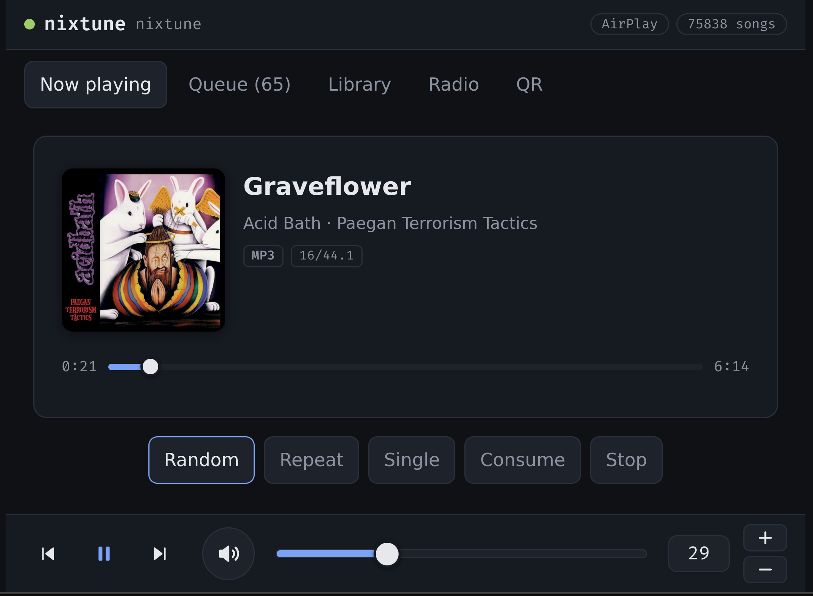
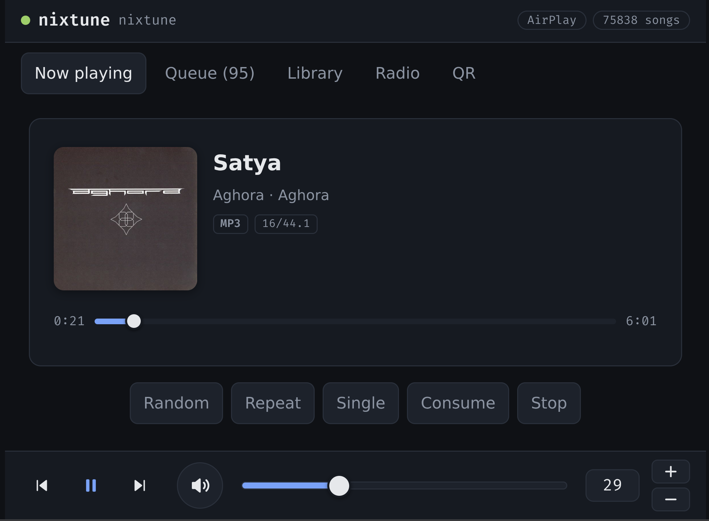
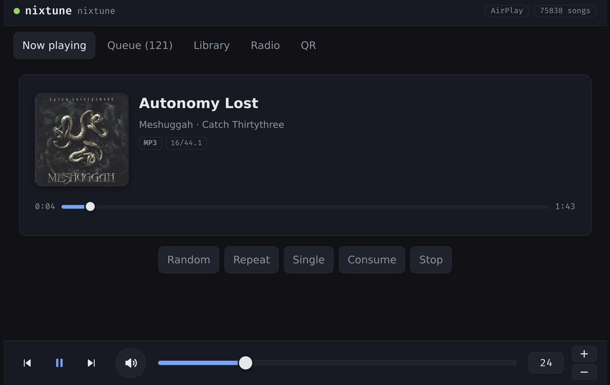

# nixtune

A network music player for a Raspberry Pi and a DAC, declared in NixOS. MPD plays to the card through ALSA with hardware volume and nothing else in the chain; AirPlay and UPnP renderers are modules you turn on; a small web page speaks the MPD protocol over one websocket. There is no settings database and no settings page: the configuration is the Nix declaration, and changing it means building a new generation, with the previous one a reboot away.

## What is in the box

`nixosModules.default` declares `services.nixtune.*`: the hardware profile, MPD, an NFS library, radio stations, the renderers and the page. Every optional part has an enable flag that defaults to off, and a part that is off contributes no package, unit, firewall rule or tab.

`nixosModules.pi5-sd` is the boot path for a Raspberry Pi 5 on the generic aarch64 SD image: nixos-hardware's Pi 5 profile, U-Boot and extlinux, an ext4 root that grows on first boot.

`overlays.default` adds `pkgs.nixtune.web`, the page, and `pkgs.nixtune.upmpdcli`, the UPnP renderer, which nixpkgs does not carry.

`nixosConfigurations.example` and `packages.aarch64-linux.image` are the starting point: one Pi 5 with a HiFiBerry DAC2 HD. Copy `nix/hosts/example.nix`, change the addresses, run `nix build .#image`, write the result to a card.

## Hardware

One profile today, `pi5-dac2hd`: a Raspberry Pi 5 with a HiFiBerry DAC2 HD. The kernel's `hifiberry-dacplushd` overlay is applied at build time with its compatible string rewritten for the Pi 5's device tree, because nixpkgs skips an overlay whose compatible string does not match the board. The ALSA card is addressed by name, `sndrpihifiberry`, so the HDMI audio devices the Pi also exposes cannot take its place by renumbering.

A second profile, `none`, plays into a null output for a rehearsal VM.

Adding a DAC is a new entry in `nix/modules/hardware.nix`: the overlay name, the ALSA card name and the mixer control.

## The page

`web/` is a Halogen application. It opens two websockets to MPD through websocat: one for commands and their replies, one parked in MPD's `idle` command so changes arrive as they happen instead of being polled. What it may show comes from `capabilities.json`, which Nix writes beside it at build time, so a renderer that is off in Nix has no badge and a host with no library has no library tab.

It is built with `mkSpagoDerivation` from `web/spago.lock`, from the PureScript registry's package set, and the result is two files, `index.html` and `index.js`, served by nginx.

## First boot on wifi

The wifi passphrase is a secret, and a secret needs a host key that does not exist until the image has booted once. So the first boot is on ethernet; the host key is read; the secret is written; the second deploy brings the wifi profile. The example host reads its passphrase from `/etc/nixtune/wifi.env`; a fleet using sops does the same through its own module.

## Not listed

I made massive changes to this to iterate on the complex task of an every day-use audio interafwce. There are a lot of non-obviouys properties of such a module that I had to arrive at through experimentation.  I have lots of ambition here and will continue to iterate.

Current screenshots:

## Maintenancee

`nix flake update` on the `update` branch, the workflow in `.github/workflows/check.yml`, merge to `main`. Nothing else.

## Licence

AGPL-3.0-or-later.